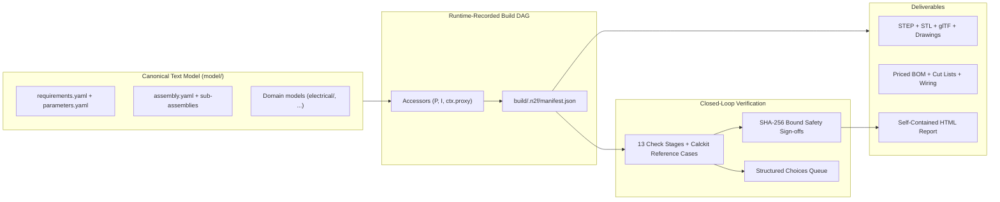
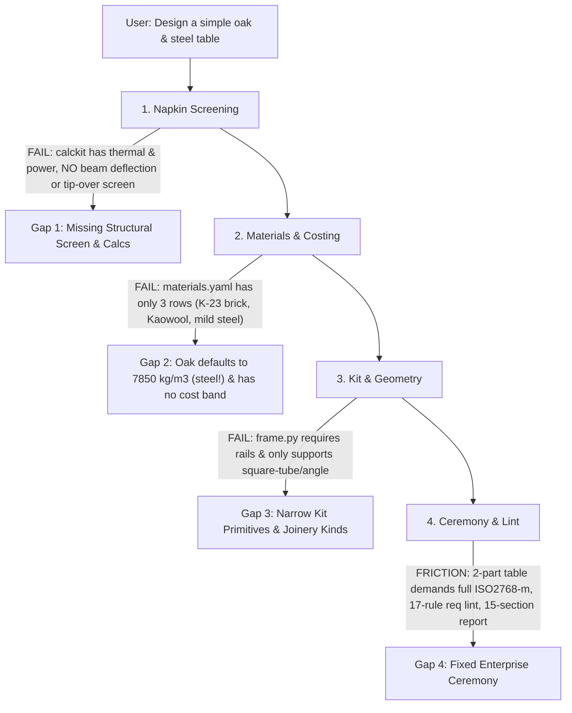
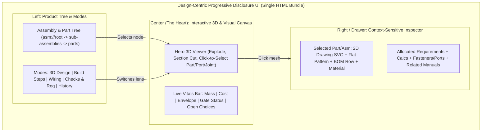

# Architectural & Product Review: `napkin2factory` (v0.6)

> [!IMPORTANT]
> **Executive Verdict:** Yes—you are heading in the right direction, and **your core foundation is exceptionally strong**. The combination of a canonical text model, runtime-recorded dependency DAG, epistemic honesty (`given` / `computed` / `estimate`), hash-bound human safety sign-offs, middle-out modular assembly (`place_by` + `ports`), and a zero-core-touch domain plugin contract ([`Domain`](../../src/napkin2factory/core/domain.py#L368-L410)) is genuinely best-in-class for agentic hardware engineering.
>
> However, to reach your full vision—**effortlessly scaling down to a simple table as well as up to a 1200 °C kiln, true progressive disclosure centered on the design, frictionless forward-and-backward iteration, and agents proactively suggesting `napkin2factory` anywhere**—there are five foundational gaps to close next.

---

## 1. Current State Snapshot (v0.6 Pause Point)

At commit `6b52115` on `main` (46.4k LoC across [`src/napkin2factory`](../../src/napkin2factory), 1,323+ tests, 141 golden snapshots), v0.6 ("the wiring") is ~95% complete. As documented in [`docs/handoffs/HANDOFF-REPORT-v0.6.md`](../handoffs/HANDOFF-REPORT-v0.6.md), three final tasks from the Gate G ([`v0.6-gate-g.md`](v0.6-gate-g.md)) and Gate H ([`v0.6-gate-h.md`](v0.6-gate-h.md)) reviews live in `.worktrees/`:

1. **`gate-g-checks`** (committed on branch `task/gate-g-checks`): Fixes Gate G blockers 1 & 2 in [`stage.py`](../../src/napkin2factory/domains/electrical/checks/stage.py)—verifying protective device rating against cable ampacity ($I_B \le I_n \le I_z$) and catching Class II insulation shortcuts inside conductive enclosures.
2. **`seam-impact`** (WIP in `.worktrees/seam-impact`): Fixes Gate H Blocker B1 in [`lifecycle.py`](../../src/napkin2factory/ecr/lifecycle.py) and [`impact.py`](../../src/napkin2factory/core/graph/impact.py), where running `n2f ecr impact` on a patch-based design ECR prints `"Impact of 0 change(s)"` and `"nothing is rebuilt"`.
3. **`wiring-disclaimer`** (WIP in `.worktrees/wiring-disclaimer`): Adds a licensed-electrician review banner and title block to [`diagram.py`](../../src/napkin2factory/domains/electrical/outputs/diagram.py) and [`schedule.py`](../../src/napkin2factory/domains/electrical/outputs/schedule.py).

---

## 2. Why Your Foundation Is Solid (What NOT to Change)

1. **Runtime-Recorded Dependency Graph (Not Heuristic Guessing):**
   [`ParameterAccessor`](../../src/napkin2factory/geometry/accessors.py) (`P["..."]`), `I["..."]`, and `ctx.proxy(...)` record exact field-level reads into `build/.n2f/manifest.json` during execution. Incremental builds (`n2f build`) and impact analysis ([`impact.py`](../../src/napkin2factory/core/graph/impact.py)) trace real edges from a parameter or port all the way to parts, assemblies, drawings, BOM rows, checks, and human sign-offs.
2. **The v0.5 Domain Plugin Contract ("A Step Is a Folder"):**
   [`Domain`](../../src/napkin2factory/core/domain.py#L368-L410) in [`domain.py`](../../src/napkin2factory/core/domain.py) cleanly decouples `core/` from engineering disciplines (`ModelFamily`, `RuleFamily`, `VerifyKind`, `CheckStage`, `GateRow`, `ReportSection`, `Screen`, `DocHelper`, `PromoteHook`). v0.6 proved this architecture under fire: the entire [`domains/electrical`](../../src/napkin2factory/domains/electrical/__init__.py) package landed with zero core edits in domain tasks, while surfacing ~12 genuine seam gaps that were cleanly resolved in `core/`.
3. **Middle-Out Modular Assembly & World-Frame Verification:**
   v0.4's `place_by` and `ports:` system ([`v0.4-product-structure.md`](../stages/v0.4-product-structure.md)) lets parts and sub-assemblies snap together by shared local frames, verifies 3D world-frame alignment and fastener counts, auto-generates A3 exploded/step assembly drawings ([`assembly_sheet.py`](../../src/napkin2factory/drawings/assembly_sheet.py)), and slices working memory via `n2f context asm://<id>`.
4. **Epistemic Honesty & Hash-Bound Safety Floor:**
   Every number carries a provenance tag (`given`, `computed`, or `estimate`). Every calculation function is backed by handbook reference cases in `calckit` verified by the `calc-case` check stage. Safety requirements (`safety: true`) can never pass by script alone—they require human sign-off bound to SHA-256 hashes of the underlying evidence files.
5. **The Choices Queue:**
   Allowing check stages to emit structured `choice` items (`n2f choices` / [`decide.py`](../../src/napkin2factory/cli/decide.py)) means even smaller or less experienced agents know *when* to pause and ask the human a concrete trade-off question with computed numbers attached.

---

## 3. Deep-Dive Evaluation Against Your Four Pillars

### Pillar 1: Accuracy

| Area | What Works Well | Critical Gaps Found |
| :--- | :--- | :--- |
| **Units & Calcs** | `pint` quantities enforced across `parameters.yaml` and `calckit`; `calc-case` verifies physics equations against textbook cases. | **Silent `UnitError` swallowing (`B-0163`):** In [`calcs.py`](../../src/napkin2factory/domains/electrical/checks/calcs.py#L207-L211), `_param_watts` catches `( pint.DimensionalityError, ValueError )` and returns `None`. A parameter with wrong units (e.g., `kg` instead of `W`) passes `n2f validate` and surfaces in `n2f check` with a misleading `"has no rating"` error. |
| **Material Physics** | Explicit density lookup in [`materials.py`](../../src/napkin2factory/geometry/materials.py) and thermal/yield properties in [`materials.yaml`](../../src/napkin2factory/calckit/data/materials.yaml). | **Silent mild-steel fallback:** [`density_kg_m3`](../../src/napkin2factory/geometry/materials.py#L72-L84) silently falls back to `DEFAULT_DENSITY = 7850.0` (`"assumed mild steel"`) when a material name is unrecognized! If an agent designs an `"oak"` or `"pine"` tabletop, `napkin2factory` calculates its mass as solid steel (`7850 kg/m³`) without failing `n2f check`! |
| **BOM & Cost Rollups** | Part mass, sheet area, and COTS unit prices roll up cleanly into `bom/rollups.json`. | **Missing Cable Costs (`B-0128`) & Unpriced Part Blindness:** Electrical cables (`cables.csv`) are not rolled into `bom/rollups.json`. Furthermore, during `n2f ecr impact`, unpriced custom parts (`unit_price: None`) report `$0.00` cost delta without flagging `"cost delta unknown (N unpriced parts)"`. |
| **Physics Coverage** | Thermal enclosure steady-state/heat-up (`thermal_enclosure.py`), electrical power/sizing (`power.py`, `wiring.py`), and mass/cost (`mass_cost.py`). | **Zero Structural / Statics Calc Pack:** There is no beam bending/deflection ($\delta = \frac{FL^3}{48EI}$), column buckling (Euler), shelf sag, fastener shear/pullout, or center-of-gravity tip-over check in `calckit` or `domains/mechanical`. |

---

### Pillar 2: Robustness & Reliability

1. **Broken Out-of-the-Box Visuals for End Users ([`pyproject.toml`](../../pyproject.toml#L18-L59)):**
   - `playwright` is only declared under `[dependency-groups] dev`, and `Pillow` (`PIL`) is not declared in runtime `dependencies` at all (`B-0072`, imported by [`render.py`](../../src/napkin2factory/geometry/render.py)).
   - When a real user installs via `uv tool install napkin2factory`, Playwright Chromium is absent, so `n2f` falls back to the software z-buffer rasterizer—or crashes if `Pillow` isn't present in the environment—producing flat, unstyled thumbnails instead of the studio Three.js renders from [`viewer.js`](../../src/napkin2factory/report/viewer.js).
2. **Cold-Start Latency (`build123d` / OCCT):**
   - First import of `build123d` / `OCP` takes 60–190s on macOS (`syspolicyd` scanning `OCP.cpython-*.so`) and adds ~1.5–2s startup overhead to CLI invocations that touch geometry.
   - Furthermore, [`improvements.md`](../improvements.md) notes `requires-python = ">=3.12,<3.13"` pins out Python 3.13/3.14 users even though `build123d >= 0.10` supports Python 3.13.
3. **Import-Order Fragility (`B-0156`) & Path Safety (`B-0105`):**
   - Importing `napkin2factory.domains.electrical` before `napkin2factory.core.registry` triggers a circular import error.
   - Rule output paths (`RuleDecl.outputs`) are not validated to stay inside `build/`, allowing a misconfigured `output_path` (`../../etc`) to write outside the build tree.
4. **File Size Creep Past Maintainability Targets:**
   - [`v0.5-foundation.md`](../stages/v0.5-foundation.md) set a 500–600 line ceiling per module, but several files have grown past 750–970 lines: [`domains/electrical/model/__init__.py`](../../src/napkin2factory/domains/electrical/model/__init__.py) (978 lines), [`domains/electrical/checks/stage.py`](../../src/napkin2factory/domains/electrical/checks/stage.py) (870 lines), [`domains/electrical/outputs/diagram.py`](../../src/napkin2factory/domains/electrical/outputs/diagram.py) (855 lines), [`core/graph/impact.py`](../../src/napkin2factory/core/graph/impact.py) (813 lines), [`report/builder.py`](../../src/napkin2factory/report/builder.py) (808 lines), and [`drawings/sheet.py`](../../src/napkin2factory/drawings/sheet.py) (756 lines).

---

### Pillar 3: Scaling Down to a "Simple Table" vs. Up to a "Kiln"

To test your vision—*"carry simple designs (e.g., a simple table) as well as complex designs (e.g., the kiln)"*—let's trace what happens today if a user asks an agent: **"Design me a simple oak-and-steel dining table (1600×800×750 mm) that holds 150 kg without sagging."**

1. **Data Tables Are Still Kiln-Shaped:**
   - [`calckit/data/materials.yaml`](../../src/napkin2factory/calckit/data/materials.yaml) contains **only 3 materials**: `K-23 insulating firebrick`, `ceramic fiber board (Kaowool 1260)`, and `mild steel`.
   - [`geometry/materials.py`](../../src/napkin2factory/geometry/materials.py#L22-L35) (`DENSITIES`) has metals, `plywood`, and `mdf`, but no `oak`, `pine`, `walnut`, `birch`, `bamboo`, `acrylic`, `polycarbonate`, `petg`, `pla`, or `carbon-fiber`.
   - [`core/data/processes.yaml`](../../src/napkin2factory/core/data/processes.yaml) has `sheet-metal`, `machining`, `welding`, `cut-block`, `cut-sheet`, `3d-print`—no `woodworking`, `cnc-routing`, `laser-cutting`, or `extrusion-cut`.
   - [`calckit/data/cost_bands.yaml`](../../src/napkin2factory/calckit/data/cost_bands.yaml) is hardcoded to the kiln's cost structure (`cut-block` is `$4.50/brick`!).
2. **Kit Primitives & Interfaces Need Everyday Hardware Vocabulary:**
   - [`frame.py`](../../src/napkin2factory/geometry/kit/frame.py#L99-L115) raises a `ValueError` if both `top_rails` and `bottom_rails` are `False` (so 4 standalone legs or trestles cannot use `frame`), and only supports `"square-tube"` and `"angle"` profiles (no round tube, tapered legs, flat bar, lumber `2x4`/board stock, or `2020`/`4040` T-slot aluminum extrusion).
   - [`interface_kinds.yaml`](../../src/napkin2factory/core/data/interface_kinds.yaml) only supports `bolt-pattern` and `mating-face` (plus `cable-entry` from electrical). Adding `wood-screw-pattern`, `dowel-joint`, `slot-tab`, `t-slot-joint`, and `hinge-mount` would unlock furniture, enclosures, and maker projects immediately.
3. **Excessive Ceremony for Simple Projects:**
   - A 2-part table currently requires the exact same file footprint and strictness as an industrial furnace: `operator.yaml`, `intake.md`, `requirements.yaml` (policed by 17 lint rules), `parameters.yaml`, `decisions.yaml`, `docs/safety.md`, `tolerance_class: ISO2768-m` on every custom part, and a 15-section report.
   - **Solution — Progressive Ceremony (`scope.level` or `profile: lite | standard | regulated`):** Allow a project to start with minimal ceremony (auto-defaulting tolerances by process, hiding empty report sections, relaxing enterprise requirement linting when `safety` is not triggered) and progressively unlock rigor as domains and risks are added.

---

### Pillar 4: Impeccable UX — Progressive Disclosure & Bidirectional Iteration

#### A. Progressive Disclosure: From a 15-Section Scroll Page to a Design-Centric Workbench

Right now, [`report.html.j2`](../../src/napkin2factory/report/templates/report.html.j2) and [`builder.py`](../../src/napkin2factory/report/builder.py#L46-L63) render **15 flat sections vertically** (`Overview`, `Safety`, `3D Model`, `Parts & BOM`, `Drawings`, `Interfaces`, `Build Plan`, `Joints`, `Wiring`, `Requirements`, `Rules`, `Sign-offs`, `Parameters`, `Decisions`, `Change Log`, `Manuals`). Even on the `Overview` card ([`overview.html.j2`](../../src/napkin2factory/report/sections/overview.html.j2)), the user only gets a static `hero.png` image, and must scroll past `Safety` to reach the interactive 3D viewer in Section 3.

To realize your vision where **"the heart of it is the design itself, and everything is reachable and available (drawings, schematics, etc.)"**:

1. **Make the Interactive 3D Design the Hero on Load:**
   - Open directly into a split/workbench layout where the interactive 3D model is front-and-center, flanked by the **Assembly Hierarchy Tree** and a **Context-Sensitive Inspector Drawer**.
2. **Part-Centric Progressive Drill-Down:**
   - Clicking any part or sub-assembly in the 3D viewport (or tree) immediately populates the Inspector Drawer with *everything about that object*: its dimensioned 2D drawing ([`drawings.html.j2`](../../src/napkin2factory/report/sections/drawings.html.j2)), sheet-metal flat pattern, BOM cost & vendor link, mating interfaces/ports, build step where it is installed, and requirements/checks allocated to it.
3. **Task-Oriented Lenses (Top Bar Tabs) Instead of a 15-Section Wall:**
   - **Design & Parts** (3D + Inspector + BOM)
   - **Drawings & Schematics** (Sheet gallery + zoomable/panable Wiring Ladder & Harness diagrams—fixing Gate H C5 in [`wiring.html.j2`](../../src/napkin2factory/domains/electrical/owner/wiring.html.j2#L10) where wide SVGs overflow a 694px scroll box)
   - **Build & Assembly** (Interactive step-by-step assembly player synced with the 3D viewer)
   - **Verification & Safety** (Requirements, Calcs, Gate Table, Sign-offs)
   - **Evolution** (Concept Board history, Decisions, ECR visual diffs)

---

#### B. Iterating Forward and Backward with Ease and Accuracy

Currently, **forward parametric iteration** works well, but **structural design iteration** and **backward iteration** have sharp edges:

1. **Backward Iteration Across the Napkin ↔ Design Boundary Is Blocked:**
   - Once a concept card is promoted via [`promote`](../../src/napkin2factory/concepts/promote/verb.py#L64-L115), `napkin2factory` locks the door: promoting another concept raises `"C-00x is already the chosen direction"`, and [`design.md`](../../examples/kiln/roles/design.md#L119) forbids editing `concepts/`.
   - If detailed CAD/wiring reveals that Concept A (`top-hat`) is too expensive or awkward and the user wants to pivot to Concept B (`front-loader`)—or spin off a Concept D informed by what was learned in CAD—there is no CLI verb to do so!
   - **What to build:**
     - `n2f concept fork-from-model <new-concept-id>`:Snapshots the current detailed `model/` back onto the napkin board as a proven baseline card.
     - `n2f concept switch <concept-id>`: Archives the current `model/` state as a named branch/snapshot in `.n2f/store/` and promotes the alternate concept card cleanly.
2. **No First-Class `n2f undo` / `n2f rollback`:**
   - While `.n2f/store/` stores content-addressed snapshots on release (`v1.0.0`, `v1.1.0`), there is no `n2f undo` or `n2f rollback` command for pre-release mistakes or reverting an applied ECR.
   - **What to build:** Auto-snapshot `model/` in `.n2f/store/` before every `promote`, `ecr apply`, or `decide`, and expose `n2f undo` / `n2f rollback <snapshot-or-tag>` with a visual diff preview.
3. **Replace Patch-String Design ECRs with Live Draft Workspaces:**
   - Today, [`lifecycle.py`](../../src/napkin2factory/ecr/lifecycle.py#L272-L300) expects a `kind: design` ECR to either carry a fragile unified-diff `patch:` string embedded inside `changes/ECR-xxx.yaml` or rely on manual out-of-band edits (which caused Gate H Blocker B1 where `n2f ecr impact` reported 0 changes).
   - **What to build:** Let agents work naturally:
     - `n2f ecr start "Add door limit switch"` → snapshots current baseline in `.n2f/store/ecr-base`.
     - The agent edits `model/` YAML and geometry scripts normally using standard file tools and runs `n2f build` / `n2f check`.
     - `n2f ecr impact` diffs the live working tree against `ecr-base` automatically—computing exact mass, cost, 3D geometry, and sign-off impacts without hand-crafted diff strings!
     - `n2f ecr abort` cleanly restores `ecr-base` if the user rejects the change.

---

#### C. "Use It Wherever, With Whatever Agent" & Proactive Agent Suggestion

Why wouldn't Claude Code, Cursor, Antigravity, Windsurf, or Codex *immediately* suggest `napkin2factory` today when a user says *"Help me design a bookshelf / robot chassis / coffee roaster"*?

Because **an agent can only suggest a tool it already knows about before the user mentions it**. Today, discovery requires the human to already know `napkin2factory` exists and paste a 4-line bootstrap prompt from [`README.md`](../../README.md#L58-L71).

To make agents proactively recommend and drive `napkin2factory` anywhere:

1. **Ship an Installable Global Agent Skill (`npx skills add` / Claude / Antigravity / Cursor Skill):**
   - Package a lightweight `SKILL.md` (installable globally into `~/.claude/skills/`, `~/.gemini/antigravity-cli/skills/`, `.cursor/rules/`, etc.) with semantic trigger keywords:
     > *"Trigger whenever the user asks to design, sketch, model, size, price, or build a physical object, furniture, bracket, enclosure, machine, or electromechanical product."*
   - When triggered, the skill instructs the agent to immediately offer: *"Want to use `napkin2factory` so we get a verified 3D model, priced BOM, engineering checks, and shop drawings instead of guessing?"*
2. **Ship an First-Class MCP Server (`n2f mcp` / `B-0036`):**
   - Expose structured MCP tools (`n2f_init`, `n2f_status`, `n2f_context`, `n2f_build_and_check`, `n2f_impact`, `n2f_decide`, `n2f_open_report`) so agents in GUI environments (Claude Desktop, Cursor, IDEs without bash loops) can drive the full workflow natively and render artifacts inline.
3. **Provide a Persistent Daemon / Pre-Warmed Worker (`n2f serve`):**
   - Keep `build123d` / OCCT and a headless browser warm in a lightweight background process (`n2f serve` or MCP server process). This drops `n2f build` + screenshot latency from ~5–15 seconds to sub-second incremental feedback, making interactive back-and-forth feel instantaneous.

---

## 4. Prioritized Roadmap to Your Vision

| Horizon | Focus | Concrete Deliverables |
| :--- | :--- | :--- |
| **Phase 0: Close v0.6** *(Immediate)* | Merge final 3 worktrees & hygiene | 1. Merge `.worktrees/gate-g-checks`, `.worktrees/seam-impact`, and `.worktrees/wiring-disclaimer`. 2. Fix [`pyproject.toml`](../../pyproject.toml) runtime dependencies (`Pillow`, optional/auto-installed `playwright` chromium, widen Python to `>=3.12,<3.15`). 3. Fix silent `UnitError` (`B-0163`), silent `DEFAULT_DENSITY` steel fallback in [`materials.py`](../../src/napkin2factory/geometry/materials.py#L84), and cable cost rollup (`B-0128`). 4. Complete [`OWNER-TODO.md`](../../OWNER-TODO.md) (rotate leaked token, lock PyPI environment tag rules). |
| **Phase 1: Everyday Designs ("The Simple Table")** *(v0.7a)* | Broaden materials, statics calcs, kit primitives, & ceremony scaling | 1. **Statics & Structural Pack (`calckit/structural.py`):** Beam/shelf deflection, Euler leg buckling, CG tip-over stability, fastener shear/pullout + `structural` napkin screen. 2. **Everyday Materials & Processes:** Add hardwoods/softwoods, extrusions, plastics, 3D-print filaments, woodworking/CNC/laser processes, and realistic cost bands. 3. **Kit Expansion:** Standalone legs, round/tapered/extrusion profiles in [`frame.py`](../../src/napkin2factory/geometry/kit/frame.py), plus wood screws, dowels, slots/tabs, and T-slot joints. 4. **Progressive Ceremony (`lite` profile):** Auto-default tolerances by process and hide unused enterprise sections on simple designs. |
| **Phase 2: Bidirectional Iteration** *(v0.7b)* | Seamless forward & backward workflow | 1. **Live Draft ECRs (`n2f ecr start / diff / abort`):** Replace brittle unified-diff patches in [`lifecycle.py`](../../src/napkin2factory/ecr/lifecycle.py) with live working-tree diffing against `.n2f/store/`. 2. **Time Travel (`n2f undo` / `n2f rollback`):** Automatic store snapshots before every state transition. 3. **Reversible Promotion (`n2f concept switch` & `fork-from-model`):** Allow stepping backward from CAD to the Concept Board without losing work. |
| **Phase 3: Progressive Disclosure Workbench** *(v0.8)* | Design-centric interactive UI | 1. Redesign [`report.html.j2`](../../src/napkin2factory/report/templates/report.html.j2) around a **Hero 3D Canvas + Assembly Tree + Part Inspector Drawer**. 2. Clicking any 3D part/sub-assembly opens its 2D drawing, flat pattern, BOM row, interfaces, and checks in place. 3. Add interactive pan/zoom viewer for wide schematics ([`wiring.html.j2`](../../src/napkin2factory/domains/electrical/owner/wiring.html.j2)). |
| **Phase 4: Ubiquitous Agent Adoption** *(v0.9–v1.0)* | "Any agent, anywhere, suggested automatically" | 1. Publish global **Agent Skill** (`npx skills add napkin2factory`) so Claude Code, Antigravity, Cursor, and Codex proactively suggest `n2f` whenever hardware design comes up. 2. Ship **`n2f mcp`** server + warm OCCT worker daemon for sub-second interactive iteration. |
