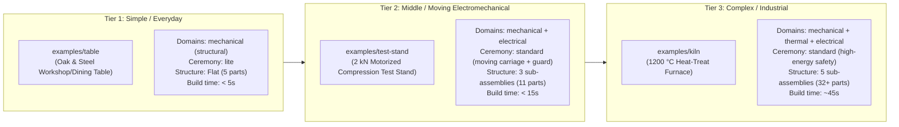

# Track A (v0.7): Everyday Breadth, Structural Physics, Progressive Ceremony & Spec-Driven Benchmarks

> [!IMPORTANT]
> **Stage Theme:** *"From a Simple Table to an Industrial Kiln"*
>
> **Goal:** Make `napkin2factory` just as natural, accurate, and fast for a 5-part everyday oak-and-steel table (`examples/desk`) or a 12-part benchtop electromechanical machine (`examples/test-stand`) as it is for the 35-part, 1200 °C furnace (`examples/kiln`)—while establishing a **deterministic, spec-driven benchmark suite** (`SPEC.md` + `SPEC.oracle.yaml`) across all three complexity tiers.

---

## 1. Vision & Problem Statement

Through v0.6, `napkin2factory` forged a rock-solid core architecture using `examples/kiln` as its proving ground. However, because the kiln is an industrial thermal/electrical machine, the system's data tables, kit generators, physics screens, and project ceremony still carry four kiln-shaped blind spots:

1. **Missing Everyday Physics (Statics & Structural Mechanics):**
   [`calckit`](../../src/napkin2factory/calckit) has thermal steady-state/heat-up (`thermal_enclosure.py`), electrical sizing (`power.py`, `wiring.py`), and mass/cost (`mass_cost.py`), but **zero structural mechanics**—no beam bending deflection, no Euler column buckling, no center-of-gravity tip-over stability, and no fastener shear/pullout checks.
2. **Narrow Material, Process & Cost Vocabularies:**
   - [`calckit/data/materials.yaml`](../../src/napkin2factory/calckit/data/materials.yaml) has only 3 entries (`K-23 insulating firebrick`, `ceramic fiber board (Kaowool 1260)`, `mild steel`).
   - [`geometry/materials.py`](../../src/napkin2factory/geometry/materials.py#L72-L84) (`density_kg_m3`) lacks hardwoods (`white-oak`, `maple`, `walnut`), softwoods (`pine`, `birch`), engineering plastics (`polycarbonate`, `pom`, `petg`, `pla`), and aluminum extrusions (`aluminum-6063-t5`), and silently falls back to `DEFAULT_DENSITY = 7850.0` (mild steel!) on unknown names.
   - [`core/data/processes.yaml`](../../src/napkin2factory/core/data/processes.yaml) and [`calckit/data/cost_bands.yaml`](../../src/napkin2factory/calckit/data/cost_bands.yaml) lack `woodworking`, `cnc-routing`, `laser-cutting`, and `extrusion-cut`.
3. **Kit & Interface Constraints on Simple Structures:**
   - [`geometry/kit/frame.py`](../../src/napkin2factory/geometry/kit/frame.py#L99-L115) requires `top_rails` or `bottom_rails` to be `True` and only supports `"square-tube"` and `"angle"` profiles.
   - [`core/data/interface_kinds.yaml`](../../src/napkin2factory/core/data/interface_kinds.yaml) only offers `bolt-pattern` and `mating-face` (plus `cable-entry`), missing `threaded-insert`, `wood-screw-pattern`, `t-slot-joint`, `dowel-joint`, and `slot-tab`.
4. **Fixed Enterprise Ceremony:**
   A 5-part wooden table currently requires the same 17-rule requirement linter, explicit `ISO2768-m` metal machining tolerances on wooden parts, and 15-section report structure as a regulated industrial furnace.

---

## 2. The 3-Tier Spec-Driven Benchmark Suite (`SPEC.md` → Product)

To test `napkin2factory` deterministically across the full complexity spectrum—both in automated CI (`pytest`) and in cold-agent trials—we introduce a three-tier benchmark ladder where every benchmark product is defined by a canonical **`SPEC.md`** and a machine-checkable **`SPEC.oracle.yaml`**.

> [!NOTE]
> **Prerequisite from `pre-v0.7-todo.md`:** Replacing the blind word grep in [`test_no_example_identifiers.py`](../../tests/unit/test_no_example_identifiers.py) with AST/URI-scoped checks during the pre-v0.7 housecleaning lets us name Tier 1 `examples/table` directly without colliding with HTML `<table>` tags in package templates.

### 2.1 How Spec-Driven Deterministic Testing Works

Each benchmark carries:
1. **`SPEC.md` (Human & Agent Input Brief):**
   - **Customer Intent & Site Envelope:** Exact dimensions, clearance limits, maximum mass, budget ceiling, and power availability.
   - **Functional & Load Requirements:** Exact static loads, deflection limits, safety factors, and electrical ratings.
   - **Candidate Concepts to Screen:** 3 named architectural concepts with specified parameters so napkin screening (`n2f concept build --all`) deterministically rejects the flawed concepts for known physics/cost/envelope reasons and promotes the winning concept.
   - **Planned Change Request (ECR):** 1 parametric ECR and 1 design ECR to test post-release iteration.
2. **`SPEC.oracle.yaml` (Automated Test Oracle):**
   - Asserts exact concept screening outcomes (`C-001: rejected (structural)`, `C-002: promoted`, `C-003: rejected (cost/mass)`).
   - Asserts parameter provenance (`computed` deflection, buckling factor of safety, tip-over factor of safety, BOM rollup cost band, total mass within $\pm 2\%$).
   - Used in two ways:
     1. **CI Regression (`tests/e2e/test_benchmarks.py`):** Verifies the shipped example against `SPEC.oracle.yaml`.
     2. **Fresh-Agent Reproduction Trial:** An evaluation harness hands a cold agent *only* `SPEC.md` in an empty directory and runs `SPEC.oracle.yaml` against the product the agent builds from scratch.

---

### 2.2 Tier 1 Specification: `examples/desk` (Heavy-Duty Oak & Steel Workshop Table)

- **Brief:** A $1600 \times 800 \times 750\text{ mm}$ workshop/dining table with a solid white-oak butcher-block top on a powder-coated steel base, supporting a $150\text{ kg}$ ($1471.5\text{ N}$) center payload with mid-span sag $\delta \le 2.5\text{ mm}$ ($L/640$), edge-load tip-over safety factor $\ge 2.0$ under a $50\text{ kg}$ ($490.5\text{ N}$) vertical load on the front overhang, total mass $\le 55\text{ kg}$, and BOM cost $\le \$450$.
- **Concept Board (3 Deterministic Cards):**
  - **`C-001` (Four Corner Tube Legs, No Apron, `22 mm` Pine Top):** Cheapest ($\sim \$180$, $24\text{ kg}$), but without steel apron rails the $22\text{ mm}$ softwood span ($E = 9.0\text{ GPa}$) sags $\delta \approx 6.8\text{ mm} > 2.5\text{ mm}$ under $150\text{ kg}$. **Rejected by `structural` screen.**
  - **`C-002` (Perimeter Steel Tube Apron Frame + `35 mm` White Oak Top):** $50 \times 50 \times 2\text{ mm}$ square-tube legs with $50 \times 25 \times 2\text{ mm}$ top apron rails and a $35\text{ mm}$ white-oak top ($E = 12.5\text{ GPa}$, $\rho = 750\text{ kg/m}^3$) fastened via M8 threaded inserts (`threaded-insert`). Composite mid-span deflection $\delta \approx 0.62\text{ mm} \le 2.5\text{ mm}$, Euler leg buckling $FS > 25$, tip-over $FS = 2.4 \ge 2.0$, mass $46\text{ kg}$, cost $\sim \$340$. **Promoted (`chosen`).**
  - **`C-003` (Heavy Welded Plate Trestle + `45 mm` Oak Top):** Passes deflection ($\delta \approx 0.35\text{ mm}$), but total mass is $74\text{ kg} > 55\text{ kg}$ (fails two-person stair carry) and cost is $\$590 > \$450$. **Rejected by `mass-cost` screen.**
- **Parts & Interfaces (5 parts, flat assembly, `ceremony: lite`):**
  1. `top-board` (`cut-sheet` / `woodworking`, `white-oak`, $1600 \times 800 \times 35\text{ mm}$, 8× M8 threaded-insert ports on underside)
  2. `apron-frame` (`welding`, `mild-steel`, `geometry.kit.frame` with `top_rails: true`, `bottom_rails: false`, 8× matching bolt-clearance tabs)
  3. `leveling-foot` (COTS × 4, M10 adjustable glide)
  4. `wood-insert-m8` (COTS × 8, M8×20 flanged threaded wood insert)
  5. `mounting-bolt-m8` (COTS × 8, M8×35 button-head hex screw + washer)

---

### 2.3 Tier 2 Specification: `examples/test-stand` (2 kN Benchtop Motorized Compression Test Stand)

- **Why `test-stand` is the ideal middle benchmark:**
  - Sits cleanly between `desk` (passive, flat, 5 parts) and `kiln` (industrial 10 kW thermal, 5 sub-assemblies, 32+ parts).
  - **Zero thermal/refractory overlap with the kiln**, proving `napkin2factory` is not a heated-box tool.
  - Exercises **sub-assemblies (`place_by` + `ports`), structural stiffness calcs, and low-voltage + mains electrical (`motor`, `psu`, `e-stop`, `sensor`, `interlock`)** in a compact 11-part design that builds in $<15\text{ s}$.
- **Brief:** A benchtop motorized force test frame for compression-testing springs and snap-fits up to $F_{\max} = 2000\text{ N}$ ($204\text{ kgf}$).
  - **Mechanical & Structural Requirements:** Vertical daylight $250\text{ mm}$, throat depth $150\text{ mm}$, bench footprint $\le 400 \times 350\text{ mm}$, total mass $\le 25\text{ kg}$ (single-person benchtop lift, OSHA/ISO manual handling limit), and **frame elastic deflection at the load axis $\delta_{\text{frame}} \le 0.20\text{ mm}$ at $2000\text{ N}$** so displacement measurements remain accurate.
  - **Electrical & Safety Requirements:** Standard 120V AC 60Hz plug-in (`IEC C14` inlet, $\le 3\text{ A}$), internal $24\text{ V DC}$ $150\text{ W}$ DIN-rail PSU, $24\text{ V DC}$ $96\text{ W}$ geared stepper/ball-screw actuator (`motor`), motion controller (`controller`), $2\text{ kN}$ S-beam load cell (`sensor`), upper & lower over-travel limit switches (`sensor`), front-panel mushroom `e-stop` cutting $24\text{ V}$ motor power, and a hinged polycarbonate fragment shield with a positive-opening guard `interlock` switch. Class I earthing of all exposed metal sub-assemblies.
- **Concept Board (3 Deterministic Cards):**
  - **`C-001` (Single-Column Cantilever C-Frame):** $60 \times 60 \times 4\text{ mm}$ steel column cantilevered from base with $150\text{ mm}$ throat overhang. Under $F = 2000\text{ N}$, combined column bending ($ML^2 / 2EI$) and overhang deflection yields $\delta_{\text{tip}} = 0.64\text{ mm} > 0.20\text{ mm}$ limit. **Rejected by `structural` stiffness screen.**
  - **`C-002` (Twin-Column Symmetric Portal Frame):** Two vertical $40 \times 40\text{ mm}$ steel/aluminum columns ($300\text{ mm}$ span) bridged by a $60 \times 40 \times 5\text{ mm}$ top crosshead beam. Columns carry pure axial tension ($1000\text{ N}$ each); top bridge in simple center-point bending deflects $\delta = \frac{FL^3}{48EI} + \delta_{\text{axial}} = 0.09\text{ mm} \le 0.20\text{ mm}$. Total mass $19.4\text{ kg} \le 25\text{ kg}$, cost $\sim \$620 \le \$800$. **Promoted (`chosen`).**
  - **`C-003` (Monolithic Machined Steel Plate Gantry):** $25\text{ mm}$ solid Blanchard-ground steel side plates. Deflection $\delta = 0.02\text{ mm}$ (passes), but mass is $38.5\text{ kg} > 25\text{ kg}$ (exceeds single-person lift limit) and machined plate cost is $\$1,150 > \$800$. **Rejected by `mass-cost` screen.**
- **Modular Structure (3 Sub-Assemblies, 11 Parts):**
  1. `asm://base-console`: Sheet-metal electronics enclosure + $12\text{ mm}$ steel base plate + lower compression platen + IEC C14 inlet + 24V PSU + controller + front E-stop.
  2. `asm://portal-gantry`: Left column + right column + top crosshead bridge + motorized linear actuator + load cell + upper/lower limit switches (mounted to `base-console` via two `bolt-pattern` column-foot interfaces and one `cable-entry` grommet).
  3. `asm://guard-shield`: Hinged polycarbonate safety door + hinge + safety interlock switch.

---

## 3. Technical Deliverables for Track A

### 3.1 `calckit/structural.py` + `structural` Napkin Screen

Add a pure-function, unit-checked (`pint`) structural mechanics module in [`src/napkin2factory/calckit/structural.py`](../../src/napkin2factory/calckit) backed by Roark's / Shigley's handbook reference cases (`tests/unit/test_structural_calcs.py` + `.cases.yaml`):

| Function | Formula / Physics | Primary Use |
| :--- | :--- | :--- |
| `rect_section_inertia(width, height)` | $I = \frac{bh^3}{12}$, $Z = \frac{bh^2}{6}$, $A = bh$ | Solid boards, plates, flat bars |
| `tube_section_inertia(width, height, thickness)` | Hollow rectangular section $I_x, I_y, A$ | Square/rectangular tube frames & columns |
| `beam_deflection_simply_supported(force, span, E, I, load_kind)` | Point center ($\frac{FL^3}{48EI}$) & uniform ($\frac{5wL^4}{384EI}$) | Tabletops, shelves, portal crossheads |
| `beam_deflection_cantilever(force, overhang, column_height, E, I_arm, I_col)` | Tip deflection from arm bending + column rotation $\frac{FL_a^3}{3EI_a} + \frac{FL_a^2 H}{EI_c}$ | Cantilever C-frames, brackets, overhanging arms |
| `beam_bending_stress(moment, section_modulus)` | $\sigma_b = \frac{M}{Z}$ and safety factor $FS_y = \frac{\sigma_y}{\sigma_b}$ | Yield margin under static load |
| `euler_buckling_load(E, I_min, length, k_factor)` | $P_{cr} = \frac{\pi^2 E I_{\min}}{(KL)^2}$, $FS_{\text{buckle}} = \frac{P_{cr}}{P}$ | Table legs, vertical columns, struts |
| `tip_over_safety_factor(mass, cg_x, edge_load, overhang_x)` | $\frac{M_{\text{restoring}}}{M_{\text{overturning}}} = \frac{m g \cdot x_{\text{support}}}{F_{\text{edge}} \cdot x_{\text{overhang}}}$ | Free-standing tables, carts, cabinets, test rigs |
| `fastener_group_shear(shear_force, count, bolt_area, shear_strength)` | $\tau = \frac{V}{n A_s}$, $FS_{\text{shear}} = \frac{\tau_{\text{allow}}}{\tau}$ | Bolted brackets, leg mounts, column bases |

- **New Generic Screen (`structural` in [`concepts/screens/`](../../src/napkin2factory/concepts/screens)):**
  When a concept card declares `loads:` (e.g., `payload_mass`, `max_deflection`, `throat_overhang`, `edge_load`), the `structural` screen evaluates deflection, yield safety factor, column buckling, and tip-over stability automatically on the Concept Board!

---

### 3.2 Expand Materials, Processes, Cost Bands & Strict Density Validation

1. **Eliminate Silent Steel Density Fallback ([`geometry/materials.py`](../../src/napkin2factory/geometry/materials.py#L72-L84)):**
   - Change `density_kg_m3` and the `materials` check stage so an unknown material name is **never** silently priced/weighed as mild steel (`7850 kg/m³`).
   - Either the material resolves in [`calckit/data/materials.yaml`](../../src/napkin2factory/calckit/data/materials.yaml) / `DENSITIES`, or the part explicitly declares `material.density_kg_m3` with a source citation, or `n2f check` fails with an actionable error listing known materials.
2. **Populate [`calckit/data/materials.yaml`](../../src/napkin2factory/calckit/data/materials.yaml) with Cited Engineering Properties ($\rho, E, \sigma_y, k$):**
   - **Metals:** `mild-steel` (A36 / S235), `stainless-304`, `stainless-316`, `aluminum-6061-t6`, `aluminum-6063-t5` (extrusions), `aluminum-5052-h32` (sheet), `brass-c360`.
   - **Woods & Sheet Goods:** `white-oak`, `hard-maple`, `walnut`, `southern-yellow-pine`, `baltic-birch-plywood`, `mdf`.
   - **Polymers & 3D Print:** `polycarbonate`, `acrylic-pmma`, `acetal-pom`, `hdpe`, `nylon-pa6`, `pla-printed`, `petg-printed`, `abs-printed`.
   - **Refractories (existing):** `K-23 insulating firebrick`, `ceramic fiber board (Kaowool 1260)`.
3. **Expand [`core/data/processes.yaml`](../../src/napkin2factory/core/data/processes.yaml) & [`calckit/data/cost_bands.yaml`](../../src/napkin2factory/calckit/data/cost_bands.yaml):**
   - Add `woodworking` (saw/plane/glue-up), `cnc-routing` (2.5D sheet/panel routing), `laser-cutting` (flat sheet/acrylic/wood), and `extrusion-cut` (cut-to-length linear profile).
   - Add corresponding low/mid/high cost bands in `cost_bands.yaml` (e.g., $/bd-ft or $/kg for timber, $/m for T-slot extrusion, $/kg for filament).

---

### 3.3 Kit & Interface Expansion

1. **Upgrade [`geometry/kit/frame.py`](../../src/napkin2factory/geometry/kit/frame.py):**
   - Allow `bottom_rails: false` (which already works for apron tables) AND support `apron_offset_top_mm` (recessed apron or flush top rails) plus mounting tab ears (`mounting_tabs`) with pre-drilled bolt holes and auto-exported `ports`!
   - Add `"round-tube"` and `"t-slot"` (simplified square profile with slot grooves) to `ProfileKind`.
2. **Add `geometry/kit/panel.py` (or extend `plate.py`):**
   - Support rectangular/rounded tabletops, shelves, and viewing windows (`polycarbonate`, `white-oak`, `plywood`) with edge chamfers/fillets and bottom/face hole patterns that export matching `ports` for `place_by`.
3. **Expand [`core/data/interface_kinds.yaml`](../../src/napkin2factory/core/data/interface_kinds.yaml):**
   - Add `threaded-insert` (wood/plastic insert + machine screw), `wood-screw-pattern`, `t-slot-joint` (T-nut + cap screw), and `hinge-pin`.

---

### 3.4 Progressive Ceremony (`ceremony: lite | standard` in `n2f.yaml`)

To ensure simple designs don't drown in industrial paperwork while preserving 100% of `napkin2factory`'s epistemic honesty:

| Feature | `ceremony: lite` (Default for 1-domain non-hazardous products) | `ceremony: standard` (Default when `safety: true` or hazardous energy is present) |
| :--- | :--- | :--- |
| **Provenance (`given`/`computed`/`estimate`)** | **Enforced** (honesty never scales down) | **Enforced** |
| **3D World-Frame & Port Alignment** | **Enforced** | **Enforced** |
| **Part `tolerance_class`** | Auto-defaults by process (`woodworking` → `±1.0 mm`, `3d-print` → `±0.3 mm`, `sheet-metal` → `ISO2768-m`) when omitted | Explicit per custom part |
| **Manuals (`model/docs/`)** | Single `build-and-care.md` (or optional if build plan covers assembly) | Full `safety.md`, `operating-manual.md`, `maintenance.md` |
| **Safety Sign-offs (`model/signoffs/`)** | Only required if a requirement carries `safety: true` | Required for all `safety: true` requirements + domain safety gates |
| **Report Sections** | Automatically omits empty enterprise sections (no empty Sign-offs, Sub-assemblies, or Change Log tables before first ECR) | Full engineering dossier |

---

## 4. Milestones & Exit Gate for Track A

1. **M1 (Statics Calc Pack & Materials):** `calckit/structural.py` + reference cases + expanded `materials.yaml`, `processes.yaml`, `cost_bands.yaml`, and strict density check in `geometry/materials.py`.
2. **M2 (Kit, Interfaces & `structural` Screen):** Upgraded `frame.py` (round tube, T-slot, mounting tabs/ports), `threaded-insert`/`t-slot-joint` interfaces, and generic `structural` napkin screen.
3. **M3 (Progressive Ceremony):** `ceremony: lite | standard` support in `n2f.yaml`, process-based default tolerances, and conditional doc/report requirements.
4. **M4 (Tier 1 & Tier 2 Benchmarks):** Build `examples/desk` (`SPEC.md` + `SPEC.oracle.yaml`) and `examples/test-stand` (`SPEC.md` + `SPEC.oracle.yaml`), plus retrofit `SPEC.md` onto `examples/kiln`.
5. **Gate A (Fresh-Agent Spec Reproduction Trial):** Hand a cold agent *only* `examples/desk/SPEC.md` and `examples/test-stand/SPEC.md` and verify it produces valid, green-checked designs matching `SPEC.oracle.yaml`.
