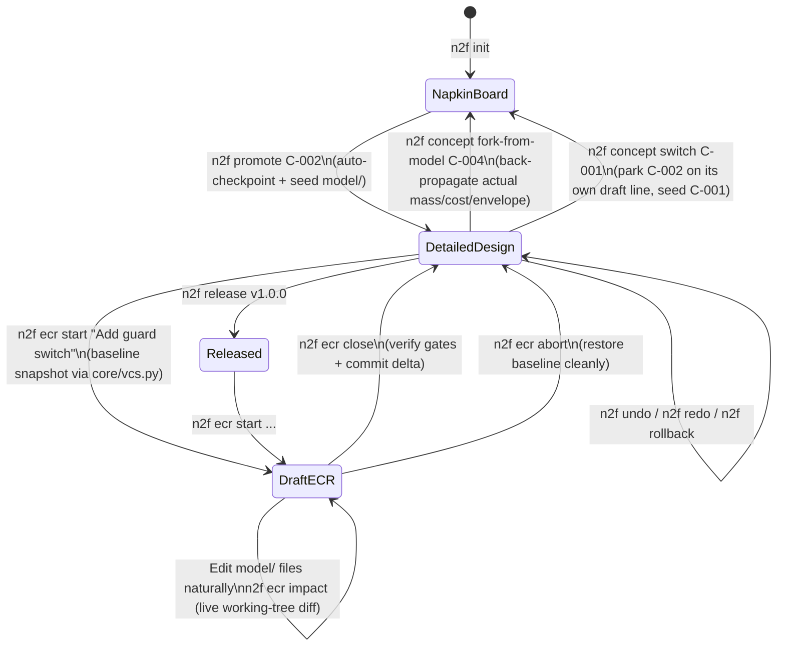

# Track B (v0.8): Bidirectional Iteration — Live Draft ECRs, Time-Travel Undo & Reversible Promotion

> [!IMPORTANT]
> **Stage Theme:** *"Forward and Backward with Ease and Accuracy"*
>
> **Goal:** Let the owner and agent iterate freely in **both directions**—forward through parametric and structural changes, and backward across bad edits, rejected ECRs, or even all the way back to the Napkin Concept Board—without ever losing work, writing fragile diff strings, or seeing misleading `"Impact of 0 change(s)"` reports.

---

## 1. Vision & Problem Statement

Hardware design is not a one-way waterfall. An owner and agent sketch concepts on a napkin, promote one to detailed CAD, discover halfway through wiring or structural checks that a sub-assembly is too heavy or awkward, try an engineering change, inspect the visual and BOM delta, and sometimes decide: *"Actually, undo that change"* or *"Wait—how does our built design compare to Concept B on the napkin board? Let's switch to Concept B."*

In v0.6, forward parametric changes work well, but four structural friction points block fluid bidirectional iteration:

1. **Fragile Patch-String Design ECRs ([`ecr/lifecycle.py`](../../src/napkin2factory/ecr/lifecycle.py#L272-L300)):**
   - For `kind: design` ECRs, `napkin2factory` expects either an embedded unified-diff `patch:` string inside `changes/ECR-xxx.yaml` or manual edits made at an ambiguous point in the lifecycle.
   - Hand-authoring unified diffs inside YAML is error-prone for agents, and editing `model/` directly caused Gate H Blocker B1 ([`v0.6-gate-h.md`](../reviews/v0.6-gate-h.md)) where `n2f ecr impact` reported `"Impact of 0 change(s)"` and `"nothing is rebuilt"`.
2. **One-Way Concept Promotion Lockout ([`concepts/promote/verb.py`](../../src/napkin2factory/concepts/promote/verb.py#L94-L99)):**
   - Once `n2f promote` runs, promoting any other concept fails permanently with `"C-00x is already the chosen direction"`, and [`roles/design.md`](../../examples/kiln/roles/design.md#L119) forbids touching `concepts/`.
   - There is no way to step back to the Concept Board, switch to an alternate concept, or feed the *real* built CAD mass/cost back onto the board to re-compare directions.
3. **No `n2f undo` / `n2f rollback` ([`core/vcs.py`](../../src/napkin2factory/core/vcs.py)):**
   - Every product folder already has change tracking through `core/vcs.py` (D31): a *snapshot* (`n2f snapshot`, and the ones commands take), a *draft* line of work, and a *Revision* at release. There is no `.n2f/store/` in the package (the first draft of this track assumed one; S-191).
   - What is missing is owner-facing time travel over those snapshots: commands do not snapshot before every state change, and there is no `undo`, `redo` or `rollback`.
   - So Track B adds **no second store**: checkpoints are snapshots, ECR baselines are snapshots, a parked concept is a draft line, all through `Vcs`.
4. **High Ceremony for Small Post-Release Tweaks:**
   - Changing a single parameter after `v1.0.0` requires 6 sequential commands (`ecr new` → `ecr impact` → `ecr approve` → `ecr apply` → `build/check` → `ecr close`).

---

## 2. Target Architecture: The Bidirectional State Machine

---

## 3. Technical Deliverables for Track B

### 3.1 Live Draft Workspaces for ECRs (`n2f ecr start | impact | abort | close`)

Replace embedded `patch:` strings in [`ecr/lifecycle.py`](../../src/napkin2factory/ecr/lifecycle.py) with **live working-tree comparison against a stored baseline snapshot**:

1. **`n2f ecr start "<title>" --reason "<why>" [--set param=val ...]`:**
   - Allocates `changes/ECR-xxx.yaml` in state `draft` (`active: true`).
   - Takes a baseline snapshot through [`core/vcs.py`](../../src/napkin2factory/core/vcs.py) and records its id in `changes/ECR-xxx.yaml` (`baseline:`). Unsaved edits present before `start` are snapshotted first, so they are never counted as part of the ECR.
   - If `--set` flags are passed, applies those parameter changes immediately to `model/parameters.yaml`.
   - For structural/design changes, the agent simply edits `model/parts/`, `model/geometry/`, `model/assemblies/`, or `model/electrical/` using normal file-editing tools!
2. **`n2f ecr impact [ECR-xxx]` (Unified Live Diff Engine in [`core/graph/impact.py`](../../src/napkin2factory/core/graph/impact.py)):**
   - Compares the current live `model/` directory against the ECR's baseline snapshot.
   - Detects **all** changes automatically:
     - Parameter value/unit deltas (`parameters.yaml`),
     - Added, modified, or removed parts, geometry scripts, interfaces, sub-assemblies, or domain files (`electrical/`),
     - Requirement or decision updates.
   - Propagates the touched set through `build/.n2f/manifest.json` (rebuilding dirty targets if needed) to report:
     - Exact **before → after** deltas for total mass, BOM cost (explicitly flagging any unpriced custom parts so cost deltas are never silently `$0.00`), and bounding envelope,
     - Every rebuilt part, drawing, schematic, and assembly step,
     - Every requirement check or human sign-off invalidated by the change,
     - Side-by-side 3D visual diff (`build/changes/ECR-xxx/diff.png` + interactive report card).
   - Writes the computed `impact:` block into `changes/ECR-xxx.yaml`.
3. **`n2f ecr approve ECR-xxx --by "<owner>"` & `n2f ecr close ECR-xxx`:**
   - Since the working tree already holds the live changes, `approve` records the owner's authorization of the computed impact **bound to the hash of the model it was computed on**, the way sign-offs are hash-bound. Any edit after approval invalidates it: `close` refuses and says "changed since it was approved; review the new impact".
   - `close` verifies that `n2f build` and `n2f check` are green and the approval's hash still matches, then marks `ECR-xxx` as `closed` and takes the final snapshot.
4. **`n2f ecr abort ECR-xxx`:**
   - Restores `model/` to the baseline snapshot (after a safety checkpoint of the aborted state, so even an abort can be undone), marks `ECR-xxx` as `aborted` (preserving the record of *why* the idea was tried and rejected in `changes/`), and leaves the workspace clean.
5. **Fast-Path Parametric ECR (`n2f ecr quick --set <k>=<v> --reason "..."`):**
   - Runs `start` + `build` + `impact` in one step and prints the owner-facing impact summary ready for `approve && close` or `abort`.
6. **Retiring `patch:` (migration, not breakage):** existing `changes/ECR-xxx.yaml` files with a `patch:` keep working: on open, an open ECR with a patch is migrated to a draft (the patch applied on top of a baseline snapshot), a closed one keeps its patch as history. A schema bump, a migration and an old fixture follow `docs/schema-policy.md` (road-to-v1.0 §3.1).

---

### 3.2 Automatic Checkpoints & Time Travel (`n2f undo`, `n2f redo`, `n2f rollback`)

Build on [`core/vcs.py`](../../src/napkin2factory/core/vcs.py): a checkpoint **is** a snapshot with a plain-language label and the product's vitals at that moment (mass, priced cost) in its message, so no separate journal file is needed. All owner-facing output stays free of git terminology (`D17`, [`docs/vocabulary.md`](../vocabulary.md)):

| CLI Command | Behavior |
| :--- | :--- |
| **Auto-Checkpointing** | Automatically snapshots `concepts/`, `model/`, and `changes/` before `promote`, `decide`, `ecr start`, `ecr close`, `ecr abort`, `concept switch`, and `release`. |
| **`n2f checkpoints`** | Lists recent design checkpoints in plain language (e.g., `#12  10 min ago  Before ECR-002 "Widen tabletop to 1800 mm"  (46.0 kg, $340)`). |
| **`n2f undo`** | Restores the previous checkpoint and prints a concise summary of what changed back. If there are unsaved edits made since the last command (an agent editing files directly), they are snapshotted first, so `undo` first undoes *those* edits and `redo` can bring them back. |
| **`n2f redo`** | Re-applies the most recently undone checkpoint. |
| **`n2f rollback <id-or-version>`** | Restores any named checkpoint (`#10`), ECR baseline (`ECR-001`), or release (`v1.0.0`) after creating a safety checkpoint of the current state. Restoring never rewrites history: it records a new state equal to the old one, so released Revisions stay immutable and rolling back to `v1.0.0` after `v1.1.0` is a new working state, released (if at all) as a new version. |
| **Sign-offs and approvals** | Restored states keep their hash-bound sign-offs only where the hashes still match; `undo` reports any sign-off or ECR approval it makes stale instead of silently reviving it. |
| **While an ECR is a draft** | `undo` and `redo` move within the ECR (never past its baseline); leaving the ECR is `ecr abort`. |

---

### 3.3 Bidirectional Napkin ↔ Design Bridge (`n2f concept switch` & `fork-from-model`)

Break the one-way wall in [`concepts/promote/verb.py`](../../src/napkin2factory/concepts/promote/verb.py) so concepts and detailed designs form a **closed loop**:

1. **`n2f concept fork-from-model <new-card-id> --title "<name>"` (Design → Napkin):**
   - Reads the current built `model/` and `build/bom/rollups.json` / `build/geometry/props.json`.
   - Creates a new concept card `concepts/<new-card-id>.yaml` populated with the **actual CAD-verified** envelope, mass, cost, and parameters (tagged `computed` from the detailed model rather than rough napkin estimates!).
   - Re-renders the Concept Board (`build/concepts/board.html`) so the owner can compare the *real built design* side-by-side against the original napkin concepts.
2. **`n2f concept switch <card-id>` (Switching Directions Safely):**
   - **What belongs to a concept, what to the product:** a concept owns its detailed design (`model/parts/`, `model/geometry/`, `model/assemblies/`, domain files such as `model/electrical/`, parameters it seeded). The product owns what holds across directions: requirements, `concepts/`, decisions about the problem (not the chosen design), operator settings, `changes/` history. Sign-offs belong to the concept whose model they hashed. The stage plan lists every folder in one of the two columns before code starts.
   - Parks the current concept's files on its own draft line through `core/vcs.py` (so zero detailed CAD or wiring work is ever lost).
   - Updates the previous concept card's status from `chosen` to `parked` (with a note recording its built mass/cost).
   - If the target concept was parked earlier, restores its detailed design; otherwise runs the standard promotion seeding from `concepts/<card-id>.yaml`. Requirements changed since it was parked are re-checked against it on the first build.
3. **`n2f concept compare`:**
   - Shows a side-by-side comparison table (and board section) of all explored concepts, distinguishing **Napkin Estimates** from **CAD-Verified Models** (`parked` / `chosen`).

---

## 4. Milestones & Exit Gate for Track B

0. **M0 (Open the track):** stage plan, decision entry and backlog rows (road-to-v1.0 §5), including the concept/product ownership table of §3.3.
1. **M1 (Checkpoints & `undo` / `redo` / `rollback` on `core/vcs.py`):** labelled snapshots before every state-changing command, unsaved-edit capture, and CLI verbs `checkpoints`, `undo`, `redo`, `rollback`; sign-off staleness reported.
2. **M2 (Live Draft ECRs):** Implement `n2f ecr start`, live working-tree `n2f ecr impact`, hash-bound `approve`, `n2f ecr abort`, `n2f ecr quick`; migrate embedded `patch:` ECRs (§3.1 item 6). Unpriced parts in cost deltas already show (S-187).
3. **M3 (Reversible Promotion & Concept Bridge):** Implement `n2f concept fork-from-model` and `n2f concept switch` with concepts parked on draft lines.
4. **M4 (Role & Guide Updates):** Update [`docs/agent-guide.md`](../agent-guide.md), `roles/pm.md`, and `roles/design.md` so agents naturally use `ecr start/impact/abort`, `undo`, and `concept switch`, within the guide's token budget (road-to-v1.0 §2.1).
5. **M5 (Thin experimental MCP & skill, Track D M0):** ship early so outside users arrive before v1.0; schemas explicitly unstable until Track D freezes them.
6. **Gate B (Forward-and-Backward Trial):** Using `examples/test-stand`, run a cold-agent trial with agents from at least two model vendors that:
   - Promotes `C-002`, builds the 3-sub-assembly CAD model,
   - Forks the built model back to the Concept Board (`fork-from-model`),
   - Switches to `C-001` (`concept switch`), observes the deflection failure, and switches back to `C-002` with zero lost work,
   - Runs a live design ECR (`ecr start` → edit CAD → `ecr impact` → `approve` → edit again → sees `close` refuse the stale approval → re-approve → `ecr close`), and tests `n2f undo` / `n2f redo`, including undoing direct file edits made between commands.
