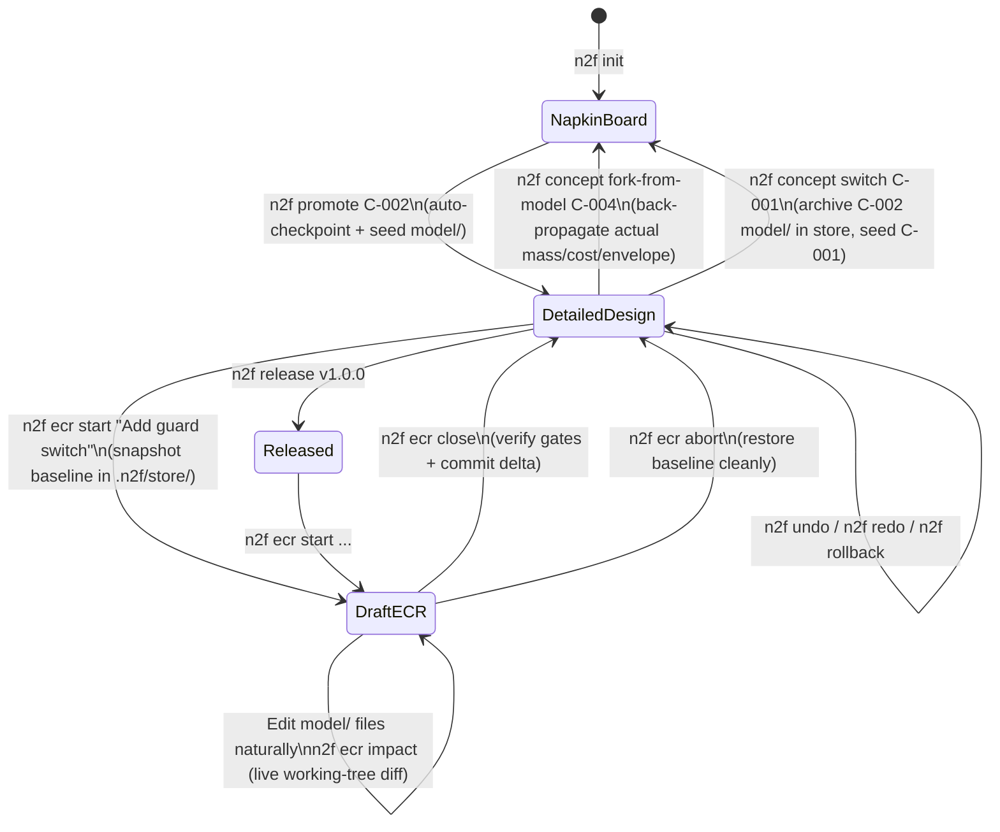

# Track B (v0.8): Bidirectional Iteration — Live Draft ECRs, Time-Travel Undo & Reversible Promotion

> [!IMPORTANT]
> **Stage Theme:** *"Forward and Backward with Ease and Accuracy"*
>
> **Goal:** Let the owner and agent iterate freely in **both directions**—forward through parametric and structural changes, and backward across bad edits, rejected ECRs, or even all the way back to the Napkin Concept Board—without ever losing work, writing fragile diff strings, or seeing misleading `"Impact of 0 change(s)"` reports.

---

## 1. Vision & Problem Statement

Hardware design is not a one-way waterfall. An owner and agent sketch concepts on a napkin, promote one to detailed CAD, discover halfway through wiring or structural checks that a sub-assembly is too heavy or awkward, try an engineering change, inspect the visual and BOM delta, and sometimes decide: *"Actually, undo that change"* or *"Wait—how does our built design compare to Concept B on the napkin board? Let's switch to Concept B."*

In v0.6, forward parametric changes work well, but four structural friction points block fluid bidirectional iteration:

1. **Fragile Patch-String Design ECRs ([`ecr/lifecycle.py`](../../src/napkin2factory/ecr/lifecycle.py#L272-L300)):**
   - For `kind: design` ECRs, `napkin2factory` expects either an embedded unified-diff `patch:` string inside `changes/ECR-xxx.yaml` or manual edits made at an ambiguous point in the lifecycle.
   - Hand-authoring unified diffs inside YAML is error-prone for agents, and editing `model/` directly caused Gate H Blocker B1 ([`v0.6-gate-h.md`](../reviews/v0.6-gate-h.md)) where `n2f ecr impact` reported `"Impact of 0 change(s)"` and `"nothing is rebuilt"`.
2. **One-Way Concept Promotion Lockout ([`concepts/promote/verb.py`](../../src/napkin2factory/concepts/promote/verb.py#L94-L99)):**
   - Once `n2f promote` runs, promoting any other concept fails permanently with `"C-00x is already the chosen direction"`, and [`roles/design.md`](../../examples/kiln/roles/design.md#L119) forbids touching `concepts/`.
   - There is no way to step back to the Concept Board, switch to an alternate concept, or feed the *real* built CAD mass/cost back onto the board to re-compare directions.
3. **No `n2f undo` / `n2f rollback` ([`core/vcs.py`](../../src/napkin2factory/core/vcs.py)):**
   - `.n2f/store/` currently snapshots the product only at formal release (`v1.0.0`, `v1.1.0`).
   - During pre-release design—where 90% of experimentation happens—there are no automatic checkpoints and no owner-friendly `undo`, `redo`, or `rollback` commands.
4. **High Ceremony for Small Post-Release Tweaks:**
   - Changing a single parameter after `v1.0.0` requires 6 sequential commands (`ecr new` → `ecr impact` → `ecr approve` → `ecr apply` → `build/check` → `ecr close`).

---

## 2. Target Architecture: The Bidirectional State Machine

---

## 3. Technical Deliverables for Track B

### 3.1 Live Draft Workspaces for ECRs (`n2f ecr start | impact | abort | close`)

Replace embedded `patch:` strings in [`ecr/lifecycle.py`](../../src/napkin2factory/ecr/lifecycle.py) with **live working-tree comparison against a stored baseline snapshot**:

1. **`n2f ecr start "<title>" --reason "<why>" [--set param=val ...]`:**
   - Allocates `changes/ECR-xxx.yaml` in state `draft` (`active: true`).
   - Takes an immutable content-addressed snapshot of `model/` in `.n2f/store/ecr/ECR-xxx-base/` via [`core/vcs.py`](../../src/napkin2factory/core/vcs.py).
   - If `--set` flags are passed, applies those parameter changes immediately to `model/parameters.yaml`.
   - For structural/design changes, the agent simply edits `model/parts/`, `model/geometry/`, `model/assemblies/`, or `model/electrical/` using normal file-editing tools!
2. **`n2f ecr impact [ECR-xxx]` (Unified Live Diff Engine in [`core/graph/impact.py`](../../src/napkin2factory/core/graph/impact.py)):**
   - Compares the current live `model/` directory against `.n2f/store/ecr/ECR-xxx-base/`.
   - Detects **all** changes automatically:
     - Parameter value/unit deltas (`parameters.yaml`),
     - Added, modified, or removed parts, geometry scripts, interfaces, sub-assemblies, or domain files (`electrical/`),
     - Requirement or decision updates.
   - Propagates the touched set through `build/.n2f/manifest.json` (rebuilding dirty targets if needed) to report:
     - Exact **before → after** deltas for total mass, BOM cost (explicitly flagging any unpriced custom parts so cost deltas are never silently `$0.00`), and bounding envelope,
     - Every rebuilt part, drawing, schematic, and assembly step,
     - Every requirement check or human sign-off invalidated by the change,
     - Side-by-side 3D visual diff (`build/changes/ECR-xxx/diff.png` + interactive report card).
   - Writes the computed `impact:` block into `changes/ECR-xxx.yaml`.
3. **`n2f ecr approve ECR-xxx --by "<owner>"` & `n2f ecr close ECR-xxx`:**
   - Since the working tree already holds the live changes, `approve` records the owner's authorization of the computed impact, and `close` verifies that `n2f build` and `n2f check` are green before marking `ECR-xxx` as `closed` and saving `.n2f/store/ecr/ECR-xxx-final/`.
4. **`n2f ecr abort ECR-xxx`:**
   - Restores `model/` back to `.n2f/store/ecr/ECR-xxx-base/`, marks `ECR-xxx` as `aborted` (preserving the record of *why* the idea was tried and rejected in `changes/`), and leaves the workspace clean.
5. **Fast-Path Parametric ECR (`n2f ecr quick --set <k>=<v> --reason "..."`):**
   - Runs `start` + `build` + `impact` in one step and prints the owner-facing impact summary ready for `approve && close` or `abort`.

---

### 3.2 Automatic Checkpoints & Time Travel (`n2f undo`, `n2f redo`, `n2f rollback`)

Extend [`core/vcs.py`](../../src/napkin2factory/core/vcs.py) with an automatic checkpoint journal in `.n2f/store/checkpoints.json` (keeping all owner-facing output 100% free of git terminology per `D17` and [`docs/vocabulary.md`](../vocabulary.md)):

| CLI Command | Behavior |
| :--- | :--- |
| **Auto-Checkpointing** | Automatically snapshots `concepts/`, `model/`, and `changes/` before `promote`, `decide`, `ecr start`, `ecr close`, `ecr abort`, `concept switch`, and `release`. |
| **`n2f checkpoints`** | Lists recent design checkpoints in plain language (e.g., `#12  10 min ago  Before ECR-002 "Widen tabletop to 1800 mm"  (46.0 kg, $340)`). |
| **`n2f undo`** | Restores the previous checkpoint, saves the undone state onto the redo stack, and prints a concise summary of what changed back. |
| **`n2f redo`** | Re-applies the most recently undone checkpoint. |
| **`n2f rollback <id-or-version>`** | Restores any named checkpoint (`#10`), ECR baseline (`ECR-001`), or release (`v1.0.0`) after creating a safety checkpoint of the current state. |

---

### 3.3 Bidirectional Napkin ↔ Design Bridge (`n2f concept switch` & `fork-from-model`)

Break the one-way wall in [`concepts/promote/verb.py`](../../src/napkin2factory/concepts/promote/verb.py) so concepts and detailed designs form a **closed loop**:

1. **`n2f concept fork-from-model <new-card-id> --title "<name>"` (Design → Napkin):**
   - Reads the current built `model/` and `build/bom/rollups.json` / `build/geometry/props.json`.
   - Creates a new concept card `concepts/<new-card-id>.yaml` populated with the **actual CAD-verified** envelope, mass, cost, and parameters (tagged `computed` from the detailed model rather than rough napkin estimates!).
   - Re-renders the Concept Board (`build/concepts/board.html`) so the owner can compare the *real built design* side-by-side against the original napkin concepts.
2. **`n2f concept switch <card-id>` (Switching Directions Safely):**
   - Archives the current `model/` directory under `.n2f/store/concepts/<previous-card-id>/` (so zero detailed CAD or wiring work is ever lost!).
   - Updates the previous concept card's status from `chosen` to `parked` (with a note recording its built mass/cost).
   - If `.n2f/store/concepts/<card-id>/` already exists from an earlier exploration, restores that detailed `model/`; otherwise runs the standard promotion seeding from `concepts/<card-id>.yaml`!
3. **`n2f concept compare`:**
   - Shows a side-by-side comparison table (and board section) of all explored concepts, distinguishing **Napkin Estimates** from **CAD-Verified Models** (`parked` / `chosen`).

---

## 4. Milestones & Exit Gate for Track B

1. **M1 (Checkpoint Store & `undo` / `redo` / `rollback`):** Extend `core/vcs.py` with automatic checkpoints and CLI verbs `checkpoints`, `undo`, `redo`, and `rollback`.
2. **M2 (Live Draft ECRs):** Implement `n2f ecr start`, live working-tree `n2f ecr impact`, `n2f ecr abort`, `n2f ecr quick`, and unpriced-part warnings in BOM cost deltas; deprecate brittle embedded `patch:` strings.
3. **M3 (Reversible Promotion & Concept Bridge):** Implement `n2f concept fork-from-model` and `n2f concept switch` with `.n2f/store/concepts/<id>/` archiving.
4. **M4 (Role & Guide Updates):** Update [`docs/agent-guide.md`](../agent-guide.md), `roles/pm.md`, and `roles/design.md` so agents naturally use `ecr start/impact/abort`, `undo`, and `concept switch`.
5. **Gate B (Forward-and-Backward Trial):** Using `examples/test-stand`, run a cold-agent trial that:
   - Promotes `C-002`, builds the 3-sub-assembly CAD model,
   - Forks the built model back to the Concept Board (`fork-from-model`),
   - Switches to `C-001` (`concept switch`), observes the deflection failure, and switches back to `C-002` with zero lost work,
   - Runs a live design ECR (`ecr start` → edit CAD → `ecr impact` → `ecr close`), and tests `n2f undo` / `n2f redo`.
