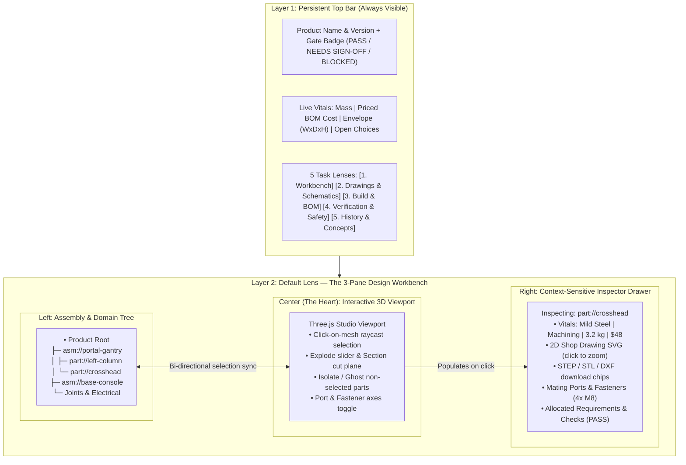

# Track C (v0.9): Progressive Disclosure Workbench — Design-Centric UI

> [!IMPORTANT]
> **Stage Theme:** *"The Heart Is the Design Itself; Everything Else Is One Click Away"*
>
> **Goal:** Replace the 15-section vertical scroll wall in [`report.html.j2`](../../src/napkin2factory/report/templates/report.html.j2) with a **Progressive Disclosure Workbench** where the interactive 3D design is front-and-center, clicking any part or sub-assembly immediately surfaces its 2D shop drawing, flat pattern, BOM row, mating fasteners, wiring terminals, and engineering checks, and every specialized lens (Drawings & Schematics, Build Player, Verification, History) is reachable without scrolling through irrelevant boilerplate.

---

## 1. Vision & Problem Statement

In v0.6, `build/report/index.html` ([`builder.py`](../../src/napkin2factory/report/builder.py#L46-L63)) renders 15 sections sequentially down a single long page:
`Overview` → `Safety` → `3D Model` → `Parts & BOM` → `Drawings` → `Interfaces` → `Build Plan` → `Joints` → `Wiring` → `Requirements` → `Rules` → `Sign-offs` → `Parameters` → `Decisions` → `Change Log` → `Manuals`.

While the data inside those 15 sections is remarkably rich, the presentation fights the user in four ways:

1. **The Design Is Buried Below the Fold:**
   When the owner opens `index.html`, they see tables and text before reaching the interactive 3D model in Section 3.
2. **Information about a Single Part Is Scattered Across 7 Sections:**
   To understand one part (e.g., `heater-plate` or `top-board`), the user must jump between `3D Model`, `Parts & BOM`, `Drawings`, `Interfaces`, `Build Plan`, `Wiring`, and `Rules`.
3. **Simple Designs Drown in Enterprise Scaffolding:**
   A 5-part table (`examples/desk`) gets the same sprawling multi-section layout as the 35-part `examples/kiln`.
4. **Wide Schematics Overflow Narrow Scroll Boxes (Gate H C5):**
   In [`wiring.html.j2`](../../src/napkin2factory/domains/electrical/owner/wiring.html.j2#L10), ladder and harness SVGs render at native pixel width (~2313 px) inside a 694 px container with horizontal scrollbars instead of fit-to-width scaling with pan/zoom.

---

## 2. Target Architecture: The Progressive Disclosure Workbench

We keep the non-negotiable single-file invariant (`D13`, `N10`: **100% self-contained `file://`-safe HTML, inline JS/CSS, embedded base64 GLBs & SVGs, ≤ 20 MB, zero external servers**), while restructuring [`report.html.j2`](../../src/napkin2factory/report/templates/report.html.j2) and [`viewer.js`](../../src/napkin2factory/report/viewer.js) around **three progressive layers**:

---

## 3. Technical Deliverables for Track C

### 3.1 Raycast Part Picking, Isolation & Section Cuts in [`viewer.js`](../../src/napkin2factory/report/viewer.js)

Upgrade `n2fCreateViewer` in [`report/viewer.js`](../../src/napkin2factory/report/viewer.js) with interactive CAD inspection primitives:

1. **Click-to-Select Mesh Picking (`THREE.Raycaster`):**
   - Clicking any 3D mesh selects that part (`part://<id>`), highlights its silhouette/emissive rim, syncs the selection in the Left Assembly Tree, and opens its dossier in the Right Inspector Drawer.
   - Double-clicking a part smoothly animates the camera (`OrbitControls.target`) to frame that part and ghosts the rest of the assembly (`opacity: 0.12`, `depthWrite: false`).
   - Clicking empty canvas background returns to the full assembly view and shows the Product Root overview in the Inspector.
2. **Interactive Explode Slider & Clipping Plane:**
   - **Explode slider (`0%` → `100%`):** Displaces parts radially or along their `place_by` assembly insertion axes (already computed for [`assembly_sheet.py`](../../src/napkin2factory/drawings/assembly_sheet.py)!).
   - **Section Cut toggle (`X` / `Y` / `Z` plane + offset slider):** Uses `THREE.Plane` local clipping so owners can look straight inside enclosed products like `examples/kiln` or `examples/test-stand`'s electronics console.

---

### 3.2 Manifest-Driven Part & Sub-Assembly Inspector Graph ([`report/builder.py`](../../src/napkin2factory/report/builder.py))

Extend [`gather`](../../src/napkin2factory/report/builder.py#L611-L725) in `report/builder.py` to emit a structured `inspector_index` JSON object embedded in the report HTML, indexed by URI (`product://root`, `asm://<id>`, `part://<id>`, `ifc://<id>`, `elec://<id>`):

| Selected Node | What the Inspector Drawer Discloses Immediately |
| :--- | :--- |
| **`product://root`** *(default on load)* | • **Product Vitals & Gate Summary** (only active gates shown) • **Open Choices Banner** (if any choices await `n2f decide`) • **Safety & Review Callouts** (if any `needs-human` sign-offs exist) • **Key Parameters Table** (`given` / `computed` / `estimate`) • **Sub-Assembly Cards** (click to isolate any module) |
| **`asm://<id>`** *(Sub-Assembly)* | • **Module Vitals:** Part count, module mass, module BOM cost • **A3 Assembly Drawing SVG** (exploded view + callouts) • **External Interfaces (`ports`):** How this module connects to sibling modules (`bolt-pattern`, `cable-entry`) • **Assembly Steps** for building this module |
| **`part://<id>`** *(Custom or COTS Part)* | • **Part Card:** Material, process, finish, mass (`computed`), dimensions, tolerance class, unit & extended cost, supplier/MPN (if COTS) • **2D Shop Drawing SVG** (inline preview + one-click fullscreen pan/zoom) & **Flat Pattern SVG** (if sheet metal) • **CAD Artifacts:** Direct links to `build/geometry/step/<id>.step`, `.stl`, `.dxf` • **Interfaces & Fasteners:** Every joint touching this part + hardware count • **Electrical Mapping:** If linked to an electrical device (`elec://<dev>`), shows its ratings, terminals, cables, and jumps to its rung in the Wiring Diagram • **Verification Trace:** Every requirement (`req://...`) and check rule (`rule://...`) that reads this part in `build/.n2f/manifest.json` |

---

### 3.3 The 5 Task-Oriented Lenses (Zero Scroll Fatigue)

Instead of rendering 15 sections stacked vertically, top-bar tabs switch the main workspace cleanly (with deep-linkable URL hashes `#lens=workbench&select=part://top-board` so every existing `#part-x` and `#drawing-x` link keeps working):

1. **Lens 1: Workbench (Default)** — 3-pane layout (`Tree` + `3D Canvas` + `Context Inspector`).
2. **Lens 2: Drawings & Schematics** — Filterable grid of all 2D part sheets, flat patterns, A3 assembly sheets, and domain schematics (Electrical Ladder & Harness diagrams).
   - **Pan/Zoom Vector Viewer:** Every SVG renders fit-to-width (`width: 100%; height: auto`) with an interactive pan/zoom toolbar (`+`, `-`, `Reset`, `Fullscreen`) and clickable callouts that jump back to the part in 3D (resolving Gate H C5).
3. **Lens 3: Build & BOM** — Interactive **Step-by-Step Assembly Player** (stepping `Step 1 → Step N` highlights the active parts and fasteners in the 3D viewer alongside the A3 step drawing!) + full **Priced BOM**, **Sheet/Tube/Timber Cut Lists**, **Fastener Schedule**, and **Cable Schedule**.
4. **Lens 4: Verification & Safety** — Requirements verification matrix, physics calculation breakdowns (`given` / `computed` / `estimate` formulas & margins), domain check rules, hash-bound human **Safety Sign-offs**, and **Owner Manuals** (`safety.md`, `operating-manual.md`, `maintenance.md`).
5. **Lens 5: History & Concepts** — Side-by-side **Napkin Concept Board** comparison (showing why the current concept won, plus any `parked` concepts from Track B), **Architecture Decisions (`DEC-xxx`)**, and **Visual ECR Diff Cards** (before/after 3D renders, mass/cost deltas).
   - *Adaptive Hiding:* On a simple project (`examples/desk` with `ceremony: lite` and no electrical domain or ECRs yet), unused domain tabs/badges stay out of the way automatically.

---

### 3.4 Print / Shop-Floor Dossier stylesheet (`@media print`)

When an owner or fabricator presses `Cmd+P` / `Ctrl+P` (or exports PDF), a dedicated `@media print` CSS layout automatically expands the lenses into a clean, page-broken shop packet:
1. Cover Sheet (Hero 3D render + Vitals + BOM Table + Cut List)
2. Step-by-Step Assembly Instructions (1 page per assembly sheet)
3. 2D Part Drawings & Flat Patterns (1 landscape page per sheet)
4. Wiring Schematics & Cable Schedule (if electrical domain is active)
5. Verification & Sign-off Certificate

---

## 4. Milestones & Exit Gate for Track C

1. **M1 (3D Viewer Picking, Isolation, Explode & Section Cuts):** Upgrade [`report/viewer.js`](../../src/napkin2factory/report/viewer.js) with raycast selection, double-click isolate/ghosting, explode slider, and XYZ clipping plane.
2. **M2 (Manifest-Backed Inspector Index):** Extend [`report/builder.py`](../../src/napkin2factory/report/builder.py) to compile `inspector_index` linking every assembly, part, joint, and electrical device to its drawings, BOM row, requirements, and checks.
3. **M3 (Workbench UI, 5 Task Lenses & Pan/Zoom SVG Viewer):** Build the new [`report.html.j2`](../../src/napkin2factory/report/templates/report.html.j2) layout, pan/zoom schematic viewer ([`wiring.html.j2`](../../src/napkin2factory/domains/electrical/owner/wiring.html.j2)), interactive Build Step Player, and `@media print` shop packet stylesheet.
4. **Gate C (Visual & Owner UX Review Across All 3 Tiers):** Capture full-page and interactive state screenshots on `examples/desk`, `examples/test-stand`, and `examples/kiln`; verify with maintainer review (`S-078`) that both the 5-part table and the 35-part kiln feel effortless to explore.
