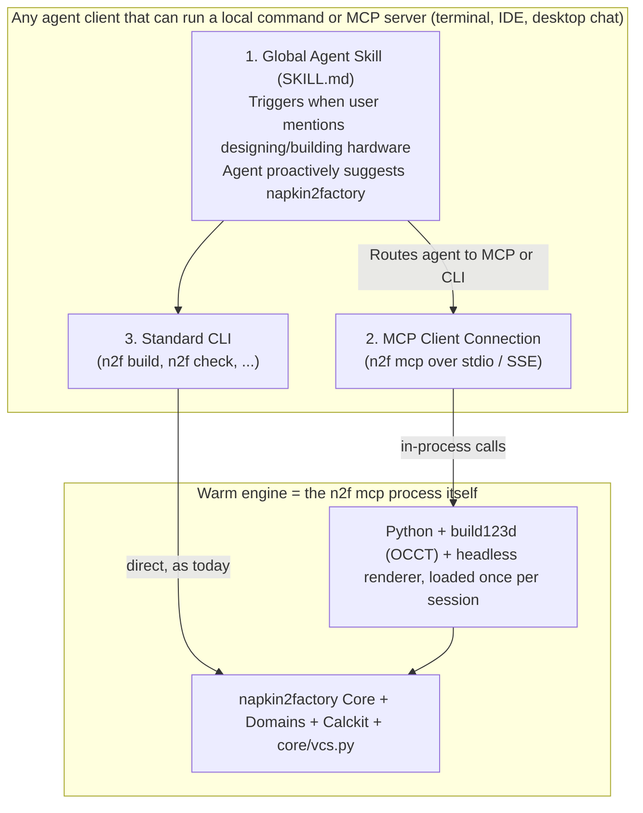

# Track D (v1.0): Ubiquitous Agent Adoption — Global Skill, MCP Server & Sub-Second Daemon

> [!IMPORTANT]
> **Stage Theme:** *"Any Agent, Anywhere — Suggested Automatically, Built Instantly"*
>
> **Goal:** Make `napkin2factory` proactively discoverable by any AI agent whenever a human talks about designing or building a physical object, usable across both CLI and GUI/IDE agent environments via a first-class **MCP Server (`n2f mcp`)** and **Global Agent Skill (`n2f skill install`)**, findable by people and agents who have never heard of it, responsive in under a second on warm incremental changes, and stable under a written v1.0 contract (road-to-v1.0 §3.1).

---

## 1. Vision & Problem Statement

The maintainer's vision (quoted in full in road-to-v1.0 §1):
> *"A user tries to design something, and the agent immediately suggests using `napkin2factory` because it helps both the agent and the user make a reliable design easily without starting from scratch."*

Today, five barriers stand between v0.6 and that experience:

1. **Zero Pre-Conversation Discovery:**
   An agent only knows `napkin2factory` exists *after* the human manually copies a 4-line bootstrap prompt from [`README.md`](../../README.md). If the user simply asks their agent *"Help me design a sturdy workbench for my garage"*, the agent starts guessing raw numbers or writing ad-hoc OpenSCAD from scratch because no global skill or MCP tool tells it `napkin2factory` is available.
   A global skill only fixes this **after** installation: it cannot make an agent suggest a tool the user has never installed. So discovery has two halves—being found before installation (registries, a zero-install start, a public page) and being suggested after it (the skill)—and both are planned and measured (§3.1).
2. **CLI-Only Execution Assumes a Local Bash Loop:**
   Agents inside desktop chat apps, browser sandboxes, or IDE sidebars often interact through **Model Context Protocol (MCP)** tools rather than raw shell scripts (`B-0036`). Even for shell-capable agents, running 5 separate CLI commands (`validate` → `lint` → `build` → `check` → `status`) burns tokens and wall-clock time.
3. **Cold-Start CAD & Render Latency (`build123d` / OCCT + Browser):**
   Every CLI invocation that touches geometry spawns a fresh Python process, re-imports `build123d` / `OCP` (~1.5–3s per command after the initial macOS `syspolicyd` scan; not re-measured for this plan), and cold-starts a renderer. `Pillow` is declared since S-182, but `playwright` is still only in `dev` in [`pyproject.toml`](../../pyproject.toml), so end users installing from PyPI get software z-buffer renders instead of Three.js studio renders.
4. **No stability promise:** v1.0 means owners and agents may build on the tool; without a written contract and a deprecation policy, every minor version may break their folders (road-to-v1.0 §3.1).
5. **No trust model:** a product's `model/geometry/*.py` is executed code. An MCP server that opens any folder an agent points it at, and owners sharing product folders, make "which code does `n2f` run, and when" a question v1.0 must answer (§3.4).

---

## 2. Target Architecture: Three Doors into One Factory

While strictly preserving the repository's vendor-neutrality rules (`S-076`, `S-077` in [`AGENTS.md`](../../AGENTS.md#L59-L65)—no model or vendor names in instructions, and no vendor dotfiles inside product folders), `napkin2factory` exposes three universal entry points backed by a single warm engine:



---

## 3. Technical Deliverables for Track D

### 3.1 Proactive Agent Discovery: Universal Skill Package & `n2f skill install`

Create a vendor-neutral skill specification in `src/napkin2factory/skill/SKILL.md` (following the open `SKILL.md` skill format) and a CLI installer `n2f skill install`. Clients without skill support get the same trigger text two other ways, so no step depends on one client (S-076, S-077): as the MCP server's own instructions, and as a short paragraph `n2f skill install --dir <path>` appends to the client's global instructions file when the owner names it.

1. **Semantic Trigger Contract (Why the Agent Suggests `n2f` Immediately):**
   The skill frontmatter description is written specifically to match hardware intent before the user ever says `"napkin2factory"`:
   ```yaml
   ---
   name: napkin2factory
   description: >
     Turn any physical product, furniture, bracket, enclosure, frame, test rig,
     or electromechanical machine idea into a verified 3D CAD model, priced BOM,
     engineering calculations, 2D shop drawings, assembly guide, and interactive
     HTML workbench. Suggest and use this skill whenever the user asks to design,
     sketch, size, model, cost, or build physical hardware. Do not suggest it for
     questions about an existing part, purely decorative objects, or software.
   ---
   ```
   The wording is tuned against the prompt set (road-to-v1.0 §4.3): should-trigger and should-not-trigger rates are measured per model vendor, not assumed.
2. **Low-Friction First Turn Behavior:**
   When triggered, the skill instructs the agent to:
   - Offer `napkin2factory` in one natural sentence in the tool's plain voice (road-to-v1.0 §1.1), for example *"I can work this out with napkin2factory: a few options on a concept board first, then a 3D model, the checks, a parts list with prices and shop drawings. Shall I start with the options?"*,
   - Start in `ceremony: lite` for simple objects (like a table, shelf, or bracket) and scale up to `standard` only if multi-domain or hazardous energy is involved,
   - Use `n2f context <uri>` to keep its context window lean.
3. **`n2f skill install [--global]`:**
   - Detects standard skill directories present on the user's machine in a vendor-neutral way (or accepts `--dir <path>`) and installs/updates the `napkin2factory` skill and `n2f mcp` registration cleanly—keeping product repositories 100% free of client-specific dotfiles (`test_no_per_client_files` stays green).
4. **Being found before installation (distribution):**
   - **Zero-install start:** `uvx --from napkin2factory n2f mcp` runs the MCP server without a prior install, so "add this MCP server" is the owner's only step.
   - **Registries:** list the MCP server in the public MCP server registries and the skill in public skill catalogues, with the same trigger description.
   - **A public page** (the agent guide, published) that a searching agent can read and act on, with the one-line install.
   - **Measured, not assumed:** at Gate D, record whether agents *without* the skill find napkin2factory by searching when asked to design hardware. This is a measure, not a pass criterion: no plan can force an outside agent to search.

---

### 3.2 First-Class MCP Server (`n2f mcp`, `B-0036`)

Implement `src/napkin2factory/mcp/server.py` (invoked via `n2f mcp`), exposing high-leverage composite tools that minimize agent round-trips and context bloat:

| MCP Tool | What It Does in One Call | Why It Helps |
| :--- | :--- | :--- |
| **`n2f_init_product`** | Initializes a product folder (`lite` or `standard`), sets `operator.yaml`, and returns the next-step checklist. | Zero boilerplate file creation. |
| **`n2f_napkin_sync`** | Runs `concept lint` + `concept build --all` + `concept board`, returning screening pass/fail tables, rejection reasons, and board screenshot paths. | 1 tool call instead of 4 shell commands. |
| **`n2f_promote_or_switch`** | Promotes a concept (`promote`), forks the built CAD model back to the board (`fork-from-model`), or switches active concepts (`concept switch`). | Seamless forward/backward architecture exploration. |
| **`n2f_context`** | Returns the focused slice (`n2f context <uri> --json`) for any `asm://`, `part://`, `ifc://`, `req://`, or `domain://`. | Prevents agents from reading 20 YAML files when editing 1 module. |
| **`n2f_sync`** | Runs `validate` + `lint` + incremental `build` + `check` in one warm in-process pass; returns gate statuses, any failing checks, open `choices`, and the updated `build/report/index.html` path. | The heartbeat tool of the design loop—sub-second when warm |
| **`n2f_decide`** | Records a choice decision (`n2f decide <id> <option>`) and immediately re-evaluates blocked gates. | Structured human-in-the-loop trade-offs. |
| **`n2f_ecr`** | Drives `start`, `impact`, `approve`, `close`, `abort`, `undo`, `redo`, and `rollback`, returning structured before/after mass, cost, and check deltas. | Accurate iteration without unified-diff strings. |

A thin, explicitly experimental version (the CLI verbs wrapped one-to-one, `--json` output passed through) ships in v0.8 as M0 (Track B M5), so outside users and agents try it while the state model is still settling. Track D then reshapes it into the composite tools above and **freezes** their names and schemas as part of the v1.0 contract. Every tool acts only inside the product folder it was opened on (§3.4).

---

### 3.3 Warm Engine & Packaging

Eliminate the per-command cold-start tax during active design sessions, without a second long-lived process:

> Amended by S-327 (v0.9 wave 6): the MCP server reuses the warm engine of S-305 (one per product folder, shared with the CLI) instead of holding the kernel itself; the engine came in v0.8, after this was written. Point 1 below stands as history.

1. **The MCP process is the warm engine.** `n2f mcp` already lives for the whole agent session, so it holds `build123d` / `OCP`, `pint` registries, domain registries and a reusable headless browser page (for [`viewer.js`](../../src/napkin2factory/report/viewer.js) screenshots) in memory and serves every tool call in-process. No socket daemon: a separate background worker would add stale-code, stale-state and local-socket security problems, and `n2f serve` is already the name of the report HTTP server (`cli/serve.py`).
   - CLI commands stay direct, as today. If the cold CLI later proves a measured bottleneck for shell-only agents, a worker is a separate decision with its own measurements.
   - **Targets are per tier and measured:** warm incremental rebuild after a one-parameter change under 1 s for Tier 1; tiers 2 and 3 set from Gate A's measurements (a kiln rebuild that re-runs OCCT booleans will not be sub-second, and the plan says so).
2. **Zero-Friction Packaging & `n2f doctor --fix`:**
   - Pillow is declared (S-182). The Python range and dependency order stay with `B-0072` (Python and dependency review); widening to 3.12 was declined.
   - Studio renders for end users: an optional extra (`napkin2factory[screenshots]`, per B-0072) carrying Playwright, which `n2f doctor --fix` installs with its headless Chromium.
   - `n2f doctor [--fix]` verifies the CAD kernel, the renderer and the skill/MCP registration, and fixes what it can.

### 3.4 Trust Model (what `n2f` runs, and when)

- **What runs:** a product's own geometry scripts and rule packs (`model/geometry/*.py`, `model/rulepacks/`, `model/screens/`) are Python executed by `n2f build` with the owner's permissions. The docs say so plainly, in the README for the owner and in the guide for the agent.
- **Folders from someone else:** opening a product folder the owner did not create (`n2f` records the creator in `n2f.yaml`) shows what code it would run and asks once before the first build; `n2f validate`, `n2f context` and reading the report never execute product code.
- **MCP scope:** every MCP tool acts only inside the product folder it was opened on (no path outside it is read or written; `..` and symlinks out are refused), and no tool runs shell commands.
- **Shipped reports** stay self-contained and run no code but their own inline viewer (D13).

---

## 4. Milestones & Exit Gate for Track D (v1.0 Release Gate)

0. **M0 (Thin experimental MCP & skill, in v0.8):** CLI verbs wrapped one-to-one, a first `SKILL.md`, shipped as Track B M5; first trigger-rate measurement on the prompt set.
1. **M1 (Packaging & `n2f doctor --fix`):** the screenshots extra, `n2f doctor --fix`, the B-0072 Python plan as it then stands.
2. **M2 (Global Agent Skill, `n2f skill install` & Distribution):** vendor-neutral `SKILL.md` with its fallbacks, `n2f skill install`, the zero-install start, registry listings, the public page; `tests/unit/test_agent_docs.py` passes.
3. **M3 (MCP Server `n2f mcp`, frozen):** the 7 composite tools backed by the in-process warm engine, folder-scoped; integration tests driving `examples/table` and `examples/test-stand` purely through MCP tool calls; tool schemas written into the v1.0 contract.
4. **M4 (Trust Model & v1.0 Contract):** §3.4, and `docs/v1-contract.md` checked against the code (road-to-v1.0 §3.1); every v0.6 fixture product opens and builds; the real-world validation of road-to-v1.0 §4.4 recorded.
5. **Gate D (The "Cold User Prompt" v1.0 Trial):**
   - **Install path:** on a clean machine, an owner who has only the README's one-line instruction gets the skill and MCP server working; record the steps and minutes.
   - **Triggering:** run the full prompt set (road-to-v1.0 §4.3) with agents from at least two model vendors; record should-trigger and should-not-trigger rates against the targets set at M0.
   - **Client kinds:** the flow below runs in a terminal agent, an IDE agent and a desktop chat app over MCP; each passes.
   - **The flow:** start a fresh agent session with the global skill + MCP server enabled and give it a plain, unprompted user request that **never mentions `napkin2factory`**:
     > *"I need a sturdy workbench for my garage (1600x800mm) that can hold a 150kg engine block without sagging, and I have a $450 budget."*
   - **Pass Criteria:**
     1. The agent immediately suggests and invokes `napkin2factory`.
     2. It screens concepts on the Napkin Board, promotes the winner, builds the 3D CAD + priced BOM + shop drawings, and opens the Progressive Disclosure Workbench (`index.html`).
     3. The user asks for one forward change (*"make it 1800mm wide"*) and one backward step (*"actually undo that, 1600mm fits my wall better"*), and both complete accurately within the measured Tier 1 targets.
     4. The same flow passes with agents from at least two model vendors, and the road-to-v1.0 §2.1 measures meet their targets.
