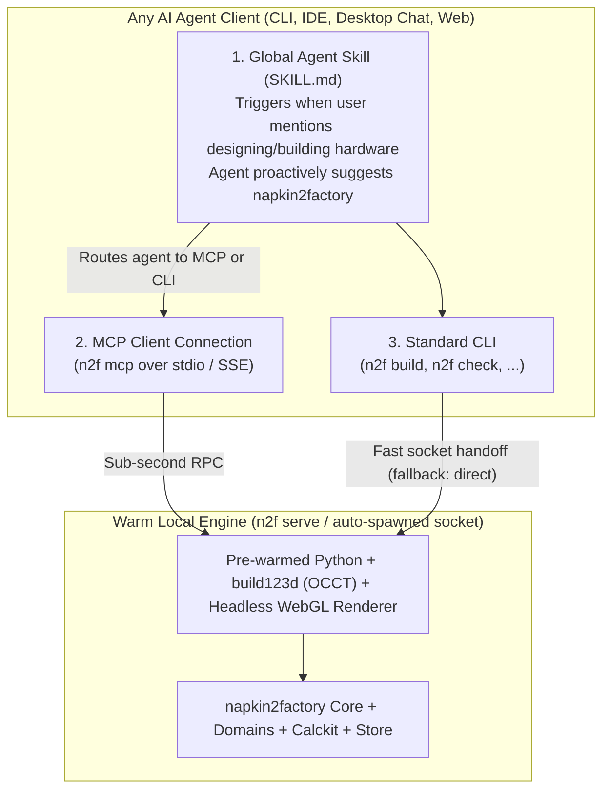

# Track D (v1.0): Ubiquitous Agent Adoption — Global Skill, MCP Server & Sub-Second Daemon

> [!IMPORTANT]
> **Stage Theme:** *"Any Agent, Anywhere — Suggested Automatically, Built Instantly"*
>
> **Goal:** Make `napkin2factory` proactively discoverable by any AI agent whenever a human talks about designing or building a physical object, usable across both CLI and GUI/IDE agent environments via a first-class **MCP Server (`n2f mcp`)** and **Global Agent Skill (`n2f skill install`)**, and responsive in under a second via a **Pre-Warmed CAD & Render Worker**.

---

## 1. Vision & Problem Statement

Your ultimate UX vision is simple and powerful:
> *"A user tries to design something, and the agent immediately suggests using `napkin2factory` because it helps both the agent and the user make a reliable design easily without starting from scratch."*

Today, three barriers stand between v0.6 and that experience:

1. **Zero Pre-Conversation Discovery:**
   An agent only knows `napkin2factory` exists *after* the human manually copies a 4-line bootstrap prompt from [`README.md`](../../README.md#L58-L71). If the user simply asks their agent *"Help me design a sturdy workbench for my garage"*, the agent starts guessing raw numbers or writing ad-hoc OpenSCAD from scratch because no global skill or MCP tool tells it `napkin2factory` is available.
2. **CLI-Only Execution Assumes a Local Bash Loop:**
   Agents inside desktop chat apps, browser sandboxes, or IDE sidebars often interact through **Model Context Protocol (MCP)** tools rather than raw shell scripts (`B-0036`). Even for shell-capable agents, running 5 separate CLI commands (`validate` → `lint` → `build` → `check` → `status`) burns tokens and wall-clock time.
3. **Cold-Start CAD & Render Latency (`build123d` / OCCT + Browser):**
   Every CLI invocation that touches geometry spawns a fresh Python process, re-imports `build123d` / `OCP` (~1.5–3s per command after initial macOS `syspolicyd` scan), and cold-starts a renderer. Worse, in [`pyproject.toml`](../../pyproject.toml#L18-L59), `Pillow` (`B-0072`) is missing from runtime `dependencies` and `playwright` is only in `dev`, so end users installing from PyPI get degraded software z-buffer renders instead of Three.js studio renders.

---

## 2. Target Architecture: Three Doors into One Factory

While strictly preserving the repository's vendor-neutrality rules (`S-076`, `S-077` in [`AGENTS.md`](../../AGENTS.md#L59-L65)—no model or vendor names in instructions, and no vendor dotfiles inside product folders), `napkin2factory` exposes three universal entry points backed by a single warm engine:



---

## 3. Technical Deliverables for Track D

### 3.1 Proactive Agent Discovery: Universal Skill Package & `n2f skill install`

Create a vendor-neutral skill specification in `src/napkin2factory/skill/SKILL.md` (following the open Agent Skills `SKILL.md` format) and a CLI installer `n2f skill install`:

1. **Semantic Trigger Contract (Why the Agent Suggests `n2f` Immediately):**
   The skill frontmatter description is written specifically to match hardware intent before the user ever says `"napkin2factory"`:
   ```yaml
   ---
   name: napkin2factory
   description: >
     Turn any physical product, furniture, bracket, enclosure, frame, test rig,
     or electromechanical machine idea into a verified 3D CAD model, priced BOM,
     engineering calculations, 2D shop drawings, assembly guide, and interactive
     HTML workbench. Suggest and use this skill whenever the user asks to design,
     sketch, size, model, cost, or build physical hardware.
   ---
   ```
2. **Low-Friction First Turn Behavior:**
   When triggered, the skill instructs the agent to:
   - Offer `napkin2factory` in one natural sentence (*"We can design this in `napkin2factory` so you get an interactive 3D model, structural/electrical checks, a priced BOM, and shop drawings automatically—want me to sketch 3 options on a concept board?"*),
   - Start in `ceremony: lite` for simple objects (like a table, shelf, or bracket) and scale up to `standard` only if multi-domain or hazardous energy is involved,
   - Use `n2f context <uri>` to keep its context window lean.
3. **`n2f skill install [--global]`:**
   - Detects standard skill directories present on the user's machine in a vendor-neutral way (or accepts `--dir <path>`) and installs/updates the `napkin2factory` skill and `n2f mcp` registration cleanly—keeping product repositories 100% free of client-specific dotfiles (`test_no_per_client_files` stays green).

---

### 3.2 First-Class MCP Server (`n2f mcp`, `B-0036`)

Implement `src/napkin2factory/mcp/server.py` (invoked via `n2f mcp`), exposing high-leverage composite tools that minimize agent round-trips and context bloat:

| MCP Tool | What It Does in One Call | Why Agents Love It |
| :--- | :--- | :--- |
| **`n2f_init_product`** | Initializes a product folder (`lite` or `standard`), sets `operator.yaml`, and returns the next-step checklist. | Zero boilerplate file creation. |
| **`n2f_napkin_sync`** | Runs `concept lint` + `concept build --all` + `concept board`, returning screening pass/fail tables, rejection reasons, and board screenshot paths. | 1 tool call instead of 4 shell commands. |
| **`n2f_promote_or_switch`** | Promotes a concept (`promote`), forks the built CAD model back to the board (`fork-from-model`), or switches active concepts (`concept switch`). | Seamless forward/backward architecture exploration. |
| **`n2f_context`** | Returns the focused slice (`n2f context <uri> --json`) for any `asm://`, `part://`, `ifc://`, `req://`, or `domain://`. | Prevents agents from reading 20 YAML files when editing 1 module. |
| **`n2f_sync`** | Runs `validate` + `lint` + incremental `build` + `check` in one warm in-process pass; returns gate statuses, any failing checks, open `choices`, and the updated `build/report/index.html` path. | The heartbeat tool of the design loop—sub-second when warm! |
| **`n2f_decide`** | Records a choice decision (`n2f decide <id> <option>`) and immediately re-evaluates blocked gates. | Structured human-in-the-loop trade-offs. |
| **`n2f_ecr`** | Drives `start`, `impact`, `approve`, `close`, `abort`, `undo`, `redo`, and `rollback`, returning structured before/after mass, cost, and check deltas. | Accurate iteration without unified-diff strings. |

---

### 3.3 Pre-Warmed CAD & Studio Render Worker (`n2f serve`)

Eliminate the 2–5 second per-command cold-start tax during active design sessions:

1. **Persistent Local Worker (`src/napkin2factory/cli/serve.py`):**
   - Holds `build123d` / `OCP`, `pint` unit registries, domain registries, and a reusable headless browser page (for [`viewer.js`](../../src/napkin2factory/report/viewer.js) GLB screenshots) warm in memory.
   - Listens on a local Unix socket (`~/.cache/n2f/worker.sock`) with an automatic idle timeout (default 15 minutes) and code-hash check (automatically restarts if `napkin2factory` version changes).
   - Both `n2f mcp` (in-process) and CLI commands (`n2f build`, `n2f concept build`, `n2f ecr impact`) transparently use the warm worker when available and fall back to direct execution when `N2F_NO_DAEMON=1` or in CI.
2. **Zero-Friction Packaging & `n2f doctor --fix`:**
   - Declare `pillow` in runtime `dependencies` in [`pyproject.toml`](../../pyproject.toml) (`B-0072`).
   - Support Python 3.12, 3.13, and 3.14 (`requires-python = ">=3.12,<3.15"`).
   - Add `n2f doctor [--fix]` to verify CAD kernel warmup, check/install the headless Chromium shell for Three.js studio screenshots, and optionally register `n2f skill install`.

---

## 4. Milestones & Exit Gate for Track D (v1.0 Release Gate)

1. **M1 (Packaging, `n2f doctor --fix` & Warm Worker Daemon):** Fix runtime dependencies in `pyproject.toml`, implement `n2f doctor --fix`, and build the warm worker socket (`n2f serve`) cutting incremental build+check+render latency below 1 second.
2. **M2 (Global Agent Skill & `n2f skill install`):** Author vendor-neutral `SKILL.md` + `n2f skill install` and verify `tests/unit/test_agent_docs.py` passes cleanly.
3. **M3 (MCP Server `n2f mcp`):** Implement the 7 composite MCP tools and resources backed by the warm worker; add integration tests driving `examples/desk` and `examples/test-stand` purely through MCP tool calls.
4. **Gate D (The "Cold User Prompt" v1.0 Trial):**
   - Start a fresh agent session with the global skill + MCP server enabled.
   - Give the agent a plain, unprompted user request that **never mentions `napkin2factory`**:
     > *"I need a sturdy workbench for my garage (1600x800mm) that can hold a 150kg engine block without sagging, and I have a $450 budget."*
   - **Pass Criteria:**
     1. The agent immediately suggests and invokes `napkin2factory`.
     2. It screens concepts on the Napkin Board, promotes the winner, builds the 3D CAD + priced BOM + shop drawings, and opens the Progressive Disclosure Workbench (`index.html`).
     3. The user asks for one forward change (*"make it 1800mm wide"*) and one backward step (*"actually undo that, 1600mm fits my wall better"*), and both complete accurately in seconds.
