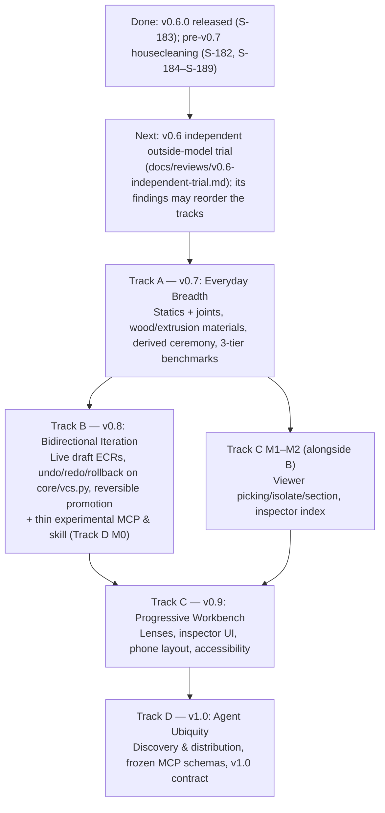

# The Road to v1.0 (`road-to-v1.0.md`)

> [!IMPORTANT]
> **Purpose of This Document:** This is the **master index and global North Star** for taking `napkin2factory` from v0.6 to v1.0. Each track document holds its own technical deliverables; this document holds the product vision, the four quality pillars, the measures that say whether the vision is reached, the v1.0 contract, the cross-track order, the shared benchmark contract and the review loop between tracks.
>
> **Revised 2026-11-04 (S-191, the roadmap review; S-192, the vision in the maintainer's words and the tool's voice):** stale "today" claims corrected against the code, benchmark numbers made reproducible, and discovery, region, trust, the v1.0 contract and ease-of-use measures added. Section 6 lists every finding and where it now lives.

---

## 1. The North Star Vision

`napkin2factory` exists so **anyone, using whatever agent they already work with, wherever that agent runs**, can turn an idea into a verified, buildable physical product—without starting from scratch and without guessing numbers.

The maintainer's own statement of it, which this document serves (quoted as written):

> What I care about:
> - Robustness
> - Reliablity
> - Accuracy
> - Ease of Use (Impeccable user expierience)
>   - I want this tool to be flexible, useful and easy to use to everyone. I want people to be able to use it wherever and with whatever agent to transform their ideas into buildable designs. I vision that the tool should be able to carry simple design (e.g. a simple table) as well as complex designs (e.g. the kiln example in the repo). Similarly, I vision the tool to be able to present those design in a progressive disclosure style where the heart of it is the design itself but everything is reachable and available to them (i.e. drawings, schematics, etc.). Think of a user trying to design something, and the agent immediately suggest using napkin2factory because it would help them (both the agent and the user) to make a reliable design easily without starting everything from scratch. Both the user and the agent would be able to iterate over the design forward and backward with ease and accuracy. This is what I envision and this is what I want the tool to be and this is what I mean by impeccable expierience.

"Wherever" means **any agent client**: the agent runs the tool, so napkin2factory works in whatever terminal agent, IDE agent or desktop chat app the person already uses. It does not mean a geographic region (supply regions are an accuracy matter, Track A §3.5).

When v1.0 is complete, the experience looks like this:
1. **Proactive Agent Suggestion:** A user tells their agent *"I want to build a sturdy oak-and-steel table"* (or a motorized test rig, or a 1200 °C kiln). Once napkin2factory is installed—or discoverable from a public registry the agent searches—the agent suggests it without the user naming it, because it gives both of them a structured napkin-to-CAD-to-shop-floor path. It does **not** suggest it for things it would not help with (a question about a part, a decorative trinket).
2. **Scales from a Simple Table to an Industrial Kiln:** A 5-part table starts in a lightweight mode (`ceremony: lite`) and builds in seconds; a 30+-part industrial furnace gets full multi-domain thermal/electrical verification and hash-bound human safety sign-offs (`ceremony: standard`). The ceremony follows from what the model contains (energy sources, domains, safety requirements), never from a preference to skip work.
3. **Any agent, any client:** the same product folder works from a terminal agent, an IDE agent or a desktop chat app, through the CLI or the MCP server, with whichever model the person uses. Nothing in the flow depends on one client's features (S-076, S-077). Chat apps that run only in a browser, with no local command or local MCP server, need a hosted service; that is a decision for after v1.0, not part of it.
4. **Design-Centric Progressive Disclosure:** Opening the report puts the **interactive 3D design front and center**. Every part, sub-assembly, 2D shop drawing, flat pattern, wiring schematic, BOM line and physics check is one click away in a context-sensitive inspector—on a laptop and on a phone.
5. **Effortless Forward & Backward Iteration:** Both the human and the agent can push the design forward (live draft ECRs with automatic 3D/BOM/check impact diffs) or step backward (`n2f undo`, `n2f rollback`, or `n2f concept switch` back to the Napkin Board) with zero lost work.

### 1.1 How the tool speaks (S-192)

Honest, not defensive; confident, not hype. napkin2factory does its best and says what it computed, and it treats the owner as a capable adult:
- **One disclaimer.** The README's disclaimer, which the agent says once at the start (agent guide, "Disclaimer first"), is the whole of it. Pages, reports, manuals and files do not repeat it; anything not shown as checked is plainly not checked, so there are no "what we did not check" lists.
- **Numbers speak through their label** (given / computed / estimate, N5) and their source, not through caveats around them.
- **No sales voice** in the README, the skill description, the agent's first offer or the report: no superlatives, no exclamation marks, no "automatically" for what is simply what the tool does. Say what it does in plain words and stop.
- **Safety stays where it acts:** a safety requirement's sign-off and a failed check say what they need, once, where the owner acts on them. That is a result, not a warning.

---

## 2. The Four Core Pillars (Applied to Every Track)

| Pillar | What It Means in Practice |
| :--- | :--- |
| **1. Accuracy** | • Zero silent fallbacks (unknown materials fail with a named list since S-186; `UnitError`s surface since S-182). • Every number carries provenance (`given`, `computed`, `estimate`) and cites a handbook reference case. • Every benchmark number is reproducible from a worked hand calculation in its `SPEC.md` (§4). • BOM and ECR deltas account for every part and cable, flagging unpriced items (S-187, S-188). • Electrical tables and cost bands state their supply region and date (Track A §3.5). |
| **2. Robustness** | • 100% self-contained `file://` HTML bundles (`≤ 20 MB`). • Strict schema validation with forward migrations (`docs/schema-policy.md`); every format change on the road to v1.0 ships its migration and old fixture. • Structural AST/URI guards instead of word bans (S-185). |
| **3. Reliability** | • Runtime-recorded dependency DAG (`build/.n2f/manifest.json`) drives incremental rebuilds and impact predictions. • Every state transition is reversible through the product's own change tracking (`core/vcs.py`: snapshots, draft lines, Revisions; D31)—one store, not a second one beside it. • Studio rendering works identically on macOS and Linux. |
| **4. Ease of Use (measured)** | • Progressive ceremony (`lite` → `standard`) matches rigor to product complexity. • Progressive disclosure UI keeps the 3D design as the hero. • Warm rebuilds and single-call MCP tools (`n2f mcp`). • Judged by the §2.1 measures, not by adjectives. |

### 2.1 How we know the vision is reached (measured at every gate)

Each track gate records these per benchmark tier, with the cold-agent trial that produced them; a number not run is written "not measured".

| Measure | What it shows | v1.0 target |
| :--- | :--- | :--- |
| Time and agent turns from the first prompt to the first report | Ease of use for the owner and the agent | Set at Gate A from the first measurement; each later gate may not regress it |
| Tokens the using-agent spends to reach the first report | Cost of using napkin2factory instead of improvising | as above |
| Size of `docs/agent-guide.md` plus the product `AGENTS.md`, in tokens | Context the using-agent must load; it grows with every track | Stays under a budget set at Gate A |
| Warm incremental rebuild time after a one-parameter change, per tier | Iteration speed | Tier 1 under 1 s; tiers 2 and 3 set from measurement |
| Skill suggestion rate on the prompt set (§4.3): should-trigger and should-not-trigger | Proactive discovery without nagging | Set at the first trial of the thin skill (Track B) |
| Oracle pass rate of cold-agent reproduction trials, per model vendor and per client kind | "Whatever agent, wherever" is true, not one setup's luck | Every tier passes with at least two vendors' models and three client kinds (terminal agent, IDE agent, desktop chat app over MCP) |

---

## 3. Global Sequencing & Document Map

Each stage builds on the previous one so we never rewrite UI or agent tools after changing the state model. Two exceptions keep the parallel agents busy and bring outside users in early: the viewer work of Track C (M1, M2) touches only `report/` and runs alongside Track B, and a thin, explicitly experimental MCP server and skill ship in v0.8 so real users arrive before v1.0 freezes the tool schemas.

| Order | Document | Version | Why It Sits Here in the Sequence |
| :--- | :--- | :--- | :--- |
| **done** | **[`pre-v0.7-todo.md`](pre-v0.7-todo.md)** | `v0.6.x` | Housecleaning landed (status at the top of that file). |
| **0** | **[`v0.6-independent-trial.md`](../reviews/v0.6-independent-trial.md)** | `v0.6.x` | An outside model uses v0.6 cold. Its findings are the first real evidence on ease of use and may change Track A's order. |
| **1** | **[`TRACK_A_EVERYDAY_BREADTH.md`](TRACK_A_EVERYDAY_BREADTH.md)** | `v0.7` | Everyday materials, statics and joint checks, derived ceremony, region-aware supply and costs, and the **3-tier benchmark suite** (`table`, `test-stand`, `kiln`) every later track is tested against. |
| **2** | **[`TRACK_B_BIDIRECTIONAL_ITERATION.md`](TRACK_B_BIDIRECTIONAL_ITERATION.md)** | `v0.8` | Finalizes the state model (`ecr start/impact/abort`, `undo/redo/rollback`, `concept switch`, `fork-from-model`) on the existing change tracking, *before* Track C renders history and *before* Track D freezes the MCP tool schemas. Ships Track D's M0 (thin experimental MCP and skill). |
| **3** | **[`TRACK_C_PROGRESSIVE_WORKBENCH.md`](TRACK_C_PROGRESSIVE_WORKBENCH.md)** | `v0.9` | Replaces the scroll report with the **3D Hero Workbench + Part Inspector**, on laptop and phone, verified on all three tiers. M1–M2 may start during Track B. |
| **4** | **[`TRACK_D_AGENT_UBIQUITY.md`](TRACK_D_AGENT_UBIQUITY.md)** | `v1.0` | Distribution and discovery, the frozen MCP tool schemas, the trust model and the v1.0 contract (§3.1). |

### 3.1 The v1.0 contract (what 1.0 promises)

v1.0 is a stability promise, so Track D's gate checks a written contract (`docs/v1-contract.md`, drafted at the start of Track D, amended by each earlier track that changes a promised surface):
- **Stable at 1.0:** the product folder format (every model under `core/model/`, `docs/schema-policy.md`), the CLI verbs and their `--json` output, the MCP tool names and schemas, the report's deep-link anchors.
- **Deprecation policy:** a promised surface changes only in a minor version that still reads the old form, with a migration (`n2f` migrates on open) and an old fixture; removal waits for the next major.
- **Migration on the road:** every v0.6 product opens in v1.0. Formats retired on the way (for example the ECR `patch:` field, Track B) get a migration, not a breaking error.
- **Not promised:** Python module paths inside the package, report HTML structure beyond its anchors, render pixels.

---

## 4. The Shared 3-Tier Spec-Driven Benchmark Contract

Across all four tracks, every feature is verified against three benchmark products—each backed by a specification (`SPEC.md`) and an automated test oracle (`SPEC.oracle.yaml`):

1. **Tier 1 — Simple (`examples/table`):** oak-and-steel workshop/dining table (1600 × 800 × 750 mm, 150 kg centre load). Tests derived `lite` ceremony, a flat assembly (5 parts), wood + steel, beam deflection, joints and tip-over (a real injury hazard, so even `lite` keeps one safety requirement), wood movement, and fast builds.
2. **Tier 2 — Middle (`examples/test-stand`):** 2 kN benchtop motorized compression test stand with a moving carriage and hinged guard. Tests derived `standard` ceremony, 3 sub-assemblies (11 parts), moving parts and travel limits, frame stiffness, plug-in mains + 24 V DC motor/E-stop/interlock wiring on a **120 V / 60 Hz** supply (the kiln is 50 Hz, so the two tiers cover both supply regions), cyclic loading, and **zero thermal overlap** with the kiln.
3. **Tier 3 — Complex (`examples/kiln`):** 1200 °C, 10 kW heat-treat furnace. Tests high-energy multi-domain (`mechanical` + `thermal` + `electrical`), 5 sub-assemblies, 30+ parts, refractories, SSR/contactor/PID/thermocouple wiring and full safety sign-offs.

### 4.1 Rules for a benchmark's numbers (S-191)
- **Worked, not stated.** Every number a `SPEC.md` asserts (deflection, factor of safety, mass, cost) is derived in the spec from its stated geometry, in a worked hand calculation with its source (handbook, table, catalogue). The oracle is built from that calculation, independently of n2f, so the benchmark checks n2f against physics rather than against itself. The first draft of Track A's numbers failed this (its table's mass and sag did not follow from its own dimensions; Track A §2).
- **Decided by physics, not rounding.** A concept rejected or promoted on a threshold sits at least 30 % from it; a borderline outcome is a redesign of the card, not a benchmark.
- **Every dimension a result depends on is written down** (column height, leg inset, overhang).
- Costs, wood and printed-plastic properties are marked `[verify]` with region and date until a human confirms them (`make verify-list`).

### 4.2 Oracle assertions
The oracle asserts outcomes, not identifiers: which concept is promoted and why each other is rejected, the computed figures within stated tolerances, the gate statuses. A cold agent's own product names its parts differently and must still pass.

### 4.3 Cold-agent trials (every gate)
- **At least two model vendors and three client kinds** (terminal agent, IDE agent, desktop chat app over MCP) per trial; a gate that passes with one setup is not passed (§2.1).
- **A prompt set, not one prompt:** for Track D's gate and the thin skill's trial, a versioned set of plain user prompts (`docs/reviews/prompt-set.yaml`) with prompts that should trigger the skill (a workbench, a bracket, a test rig) and prompts that should not (a question about a bolt grade, a decorative trinket, software work), so both missed and unwanted suggestions are counted.
- **Outside the repository:** the trial agent starts in an empty folder with only what an owner would have.

### 4.4 Real-world validation (before v1.0)
"Verified buildable" is checked against reality once: build Tier 1 from its report, or at minimum have a fabricator quote service accept its DXF/STEP files and record what it rejected. The outcome is a decision entry; anything it finds becomes backlog work before the v1.0 tag.

---

## 5. Inter-Track Revision Protocol

At the end of each track (`v0.7` → `v0.8` → `v0.9` → `v1.0`):
1. Run the **Fresh-Context Review Gates** (Engineering/Honesty Gate + Owner UX Gate + Cold-Agent `SPEC.md` Reproduction Trial with two vendors, §4.3), the health review (S-190), and record the §2.1 measures.
2. Re-read this document and the **next track's plan**, updating assumptions, schemas or backlog items found during the completed track.
3. **Open the next track as a stage plan:** its first task turns the track document into `docs/stages/v0.<n>-<name>.md` with milestone ids, writes the decision entry that adopts it, and files its open items as `BACKLOG.md` rows—the same journals every earlier version used, so no agent works from an unlisted plan.
4. Check every "today" claim in the next track against the code before building on it (the S-191 review found five stale ones).
5. Count the `core/` files each domain or calc-pack milestone touched, as v0.6 did (its domain milestones touched 0); a rising count means the contract needs a seam task, not a workaround.

---

## 6. Review findings and where they now live (S-191, 2026-11-04)

| Finding | Now in |
| :--- | :--- |
| Track B planned a second snapshot store (`.n2f/store/`, `checkpoints.json`); products already version through `core/vcs.py` (snapshots, draft lines, Revisions) | Track B §1, §3.2 |
| `n2f serve` already exists (the report HTTP server); Track D reused the name for a daemon | Track D §3.3 |
| Track D's packaging claims were stale (Pillow declared in S-182; Python widening declined, B-0072) | Track D §1, §3.3 |
| Track A's density-fallback blind spot was already fixed (S-186) | Track A §1 |
| `desk` / `table` naming and part counts disagreed | Track A §2, §4 here |
| `structural` screen read `throat_overhang`, an example's word (F9, S-128) | Track A §3.1 |
| Benchmark numbers not reproducible from their own geometry; C-002's mass near its limit | Track A §2, §4.1 here |
| Wood movement, creep, racking, joint moment, insert pull-out, fatigue, safety-factor basis missing | Track A §3.1 |
| `lite` ceremony could be chosen to skip checks; tip-over is a safety hazard | Track A §3.4 |
| Region: mains, electrical tables, units, dated cost bands (an accuracy matter; S-192 corrected S-191, which read the vision's "anywhere" as geography) | Track A §3.2, §3.5; §2 pillar 1 here |
| Discovery needs the tool installed first; the trial pre-enabled the skill | Track D §3.1, Gate D |
| "Any agent" tested with one model and one prompt | §4.3 here, Track D Gate D |
| "Wherever" means any agent client; browser-only chats need a hosted service (after v1.0) | §1 here, Track D §2 |
| The tool's voice: one disclaimer, plain words, no sales voice, no repeated warnings | §1.1 here; B-0186 for the electrical domain's repeats |
| No v1.0 contract or migration path | §3.1 here |
| No trust model for running a shared product's geometry scripts | Track D §3.4 |
| No ease-of-use measures | §2.1 here |
| ECR approval not bound to the model it approved | Track B §3.1 |
| Undo after edits made outside any command undefined | Track B §3.2 |
| What a concept owns vs what the product owns undefined for `concept switch` | Track B §3.3 |
| Separate warm daemon adds stale-state and socket risk; the MCP process is already warm | Track D §3.3 |
| Distribution only at v1.0; viewer work serialized behind Track B | §3 here, Track D M0 |
| Workbench had no phone layout, accessibility or interaction tests | Track C §3.5, M4 |
| "Verified buildable" never checked against a real build | §4.4 here |
