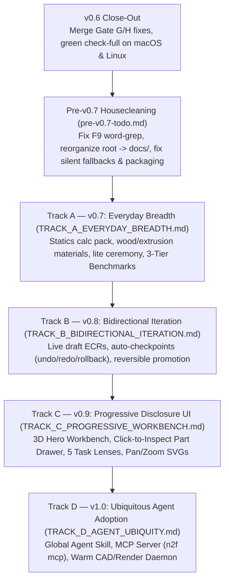

# The Road to v1.0 (`road-to-v1.0.md`)

> [!IMPORTANT]
> **Purpose of This Document:** This is the **master index and global North Star** for taking `napkin2factory` from v0.6 to v1.0. Each individual track document focuses only on its own technical deliverables, while this document holds the overarching product vision, the four non-negotiable quality pillars, the cross-track dependency order, the shared 3-tier benchmark contract, and the review loop between tracks.

---

## 1. The North Star Vision

`napkin2factory` exists so **anyone, anywhere, using any AI agent** can turn an idea into a verified, buildable physical product—without starting from scratch and without guessing numbers.

When v1.0 is complete, the experience looks like this:
1. **Proactive Agent Suggestion:** A user tells their agent *"I want to build a sturdy oak-and-steel table"* (or a motorized test rig, or a 1200 °C kiln). Without the user ever needing to mention `napkin2factory`, the agent immediately suggests using it because it gives both the agent and the user a structured napkin-to-CAD-to-shop-floor factory.
2. **Scales from a Simple Table to an Industrial Kiln:** A 5-part table starts in a lightweight, low-ceremony mode (`ceremony: lite`) and builds in seconds; a 35-part industrial furnace gets full multi-domain thermal/electrical verification and hash-bound human safety sign-offs (`ceremony: standard`).
3. **Design-Centric Progressive Disclosure:** Opening the report puts the **interactive 3D design front and center**. Every part, sub-assembly, 2D shop drawing, flat pattern, wiring schematic, BOM line, and physics check is one click away in a context-sensitive inspector—never buried in a 15-section vertical scroll wall.
4. **Effortless Forward & Backward Iteration:** Both the human and the agent can push the design forward (live draft ECRs with automatic 3D/BOM/check impact diffs) or step backward (`n2f undo`, `n2f rollback`, or `n2f concept switch` back to the Napkin Board) with zero lost work.

---

## 2. The Four Core Pillars (Applied to Every Track)

Every milestone from v0.7 through v1.0 is judged against four non-negotiable pillars:

| Pillar | What It Means in Practice |
| :--- | :--- |
| **1. Accuracy** | • Zero silent fallbacks (never assume mild steel density for unknown materials; never swallow `UnitError`s). • Every number carries provenance (`given`, `computed`, `estimate`) and cites handbook reference cases. • BOM and ECR deltas account for every part and cable (explicitly flagging unpriced items). |
| **2. Robustness** | • 100% self-contained `file://` HTML bundles (`≤ 20 MB`). • Strict schema validation with forward migrations (`docs/schema-policy.md`). • Structural AST/URI guards instead of brittle regex word bans. |
| **3. Reliability** | • Runtime-recorded dependency DAG (`build/.n2f/manifest.json`) drives incremental rebuilds and impact predictions. • Content-addressed checkpoints in `.n2f/store/` ensure every state transition is reversible. • Out-of-the-box studio rendering works identically on macOS and Linux. |
| **4. Impeccable Ease of Use** | • Progressive ceremony (`lite` → `standard`) matches rigor to product complexity. • Progressive disclosure UI keeps the 3D design as the hero. • Sub-second warm rebuilds (`n2f serve`) + single-call MCP tools (`n2f mcp`). |

---

## 3. Global Sequencing & Document Map

Each stage builds directly on the previous one so we never have to rewrite UI or agent tools after changing the underlying state model:

| Order | Document | Version | Why It Sits Here in the Sequence |
| :--- | :--- | :--- | :--- |
| **0** | **[`pre-v0.7-todo.md`](pre-v0.7-todo.md)** | `v0.6.x` | Cleans up the repo root (`docs/stages/`, `docs/roadmap/`, `docs/handoffs/`), replaces the false-positive token scanner in [`test_no_example_identifiers.py`](../../tests/unit/test_no_example_identifiers.py), fixes silent density/unit fallbacks, and splits 800+ line files before new features land. |
| **1** | **[`TRACK_A_EVERYDAY_BREADTH.md`](TRACK_A_EVERYDAY_BREADTH.md)** | `v0.7` | Gives the system everyday materials, structural/statics physics (`calckit/structural.py`), `ceremony: lite`, and the **3-tier benchmark suite** (`table`, `test-stand`, `kiln`) so Tracks B, C, and D are tested across simple, middle, and complex designs. |
| **2** | **[`TRACK_B_BIDIRECTIONAL_ITERATION.md`](TRACK_B_BIDIRECTIONAL_ITERATION.md)** | `v0.8` | Finalizes the state machine (`ecr start/impact/abort`, `undo/redo/rollback`, `concept switch`, `fork-from-model`) *before* Track C renders history/diffs in the UI and *before* Track D freezes the MCP tool schemas. |
| **3** | **[`TRACK_C_PROGRESSIVE_WORKBENCH.md`](TRACK_C_PROGRESSIVE_WORKBENCH.md)** | `v0.9` | Replaces the 15-section scroll report with the **3D Hero Workbench + Part Inspector Drawer**, verified simultaneously against `examples/table` (`lite`), `examples/test-stand` (moving parts + electrical), and `examples/kiln` (industrial). |
| **4** | **[`TRACK_D_AGENT_UBIQUITY.md`](TRACK_D_AGENT_UBIQUITY.md)** | `v1.0` | Opens the distribution floodgates (`SKILL.md`, `n2f mcp`, `n2f serve` warm daemon) once everyday breadth, bidirectional iteration, and the progressive workbench UI are rock-solid. |

---

## 4. The Shared 3-Tier Spec-Driven Benchmark Contract

Across all four tracks, every feature is verified against three deterministic benchmark products—each backed by a human/agent specification (`SPEC.md`) and an automated test oracle (`SPEC.oracle.yaml`):

1. **Tier 1 — Simple (`examples/table`):**
   - *Archetype:* Heavy-duty oak-and-steel workshop/dining table ($1600 \times 800 \times 750\text{ mm}$, $150\text{ kg}$ center load).
   - *What it tests:* `ceremony: lite`, flat assembly (5 parts), wood + steel materials, beam deflection & tip-over statics, and fast (<5s) builds.
2. **Tier 2 — Middle (`examples/test-stand`):**
   - *Archetype:* $2\text{ kN}$ benchtop motorized compression test stand with a moving actuator carriage and hinged polycarbonate guard.
   - *What it tests:* `ceremony: standard`, 3 modular sub-assemblies (`base-console`, `portal-gantry`, `guard-shield`), moving parts & travel limit switches, crosshead stiffness ($\delta \le 0.20\text{ mm}$), and plug-in AC + 24V DC motor/E-stop/interlock wiring—with **zero thermal overlap** with the kiln.
3. **Tier 3 — Complex (`examples/kiln`):**
   - *Archetype:* $1200\text{ }^\circ\text{C}$, $10\text{ kW}$ industrial heat-treat furnace.
   - *What it tests:* High-energy multi-domain (`mechanical` + `thermal` + `electrical`), 5 sub-assemblies, 32+ parts, refractory bricks/fiber, 45A SSR/contactor/PID/thermocouple wiring, and full safety sign-offs.

---

## 5. Inter-Track Revision Protocol

At the end of each track (`v0.6.x` → `v0.7` → `v0.8` → `v0.9` → `v1.0`):
1. Run the **Fresh-Context Review Gates** (Engineering/Honesty Gate + Owner UX Gate + Cold-Agent `SPEC.md` Reproduction Trial).
2. Re-read this `road-to-v1.0.md` and the **next track's plan document**, updating any assumptions, schemas, or backlog items discovered during the completed track before opening the next track's first task branch.
